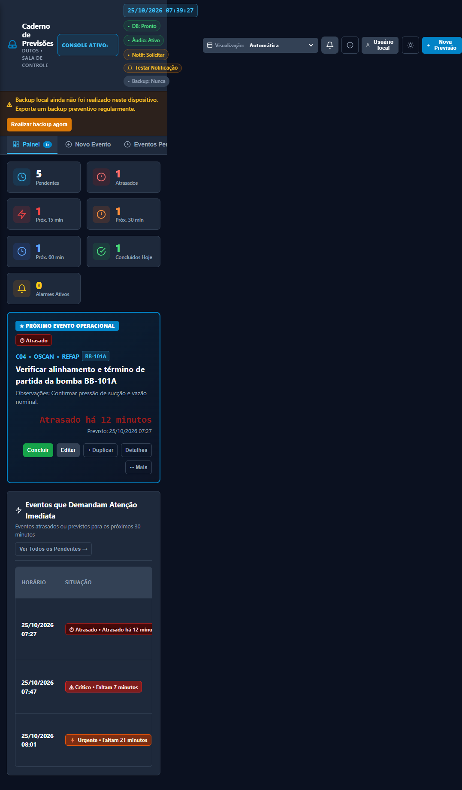
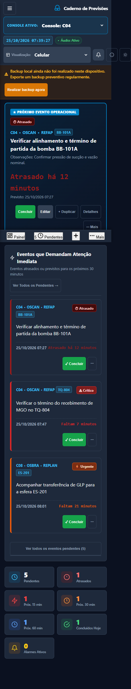
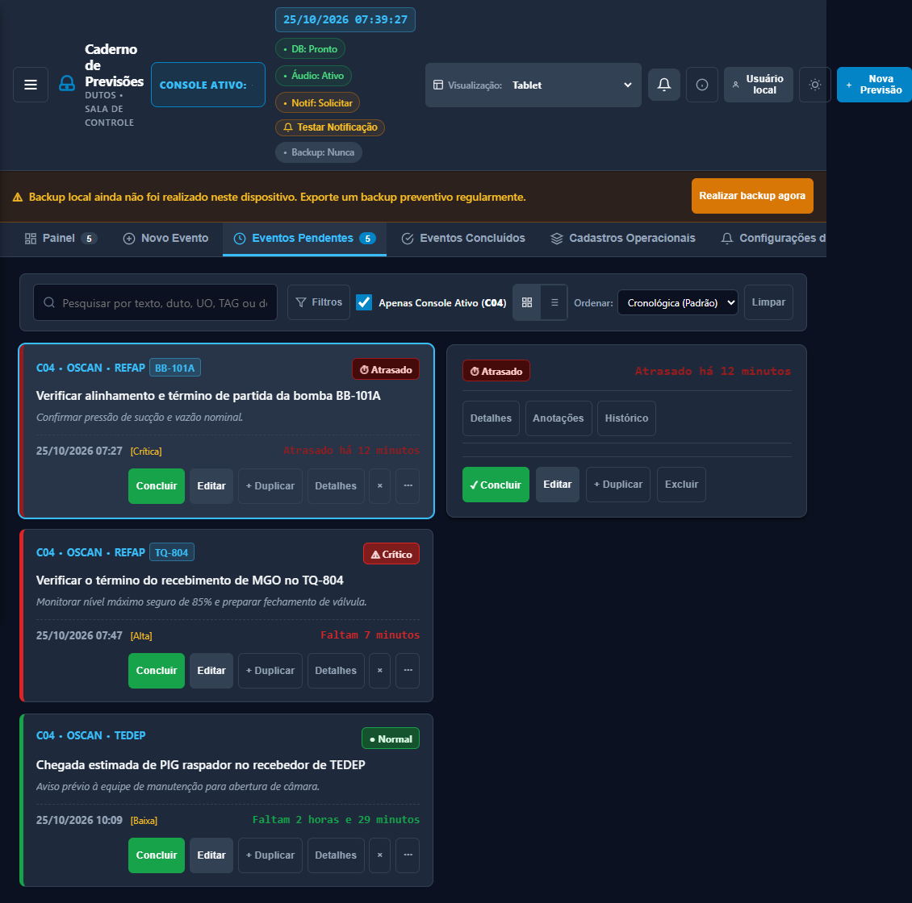
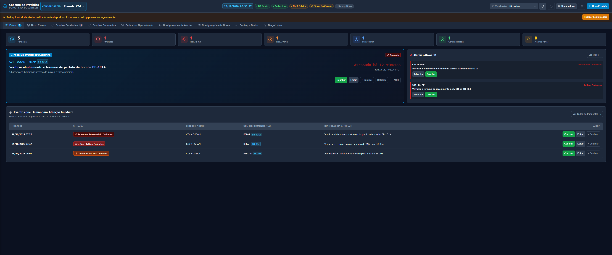
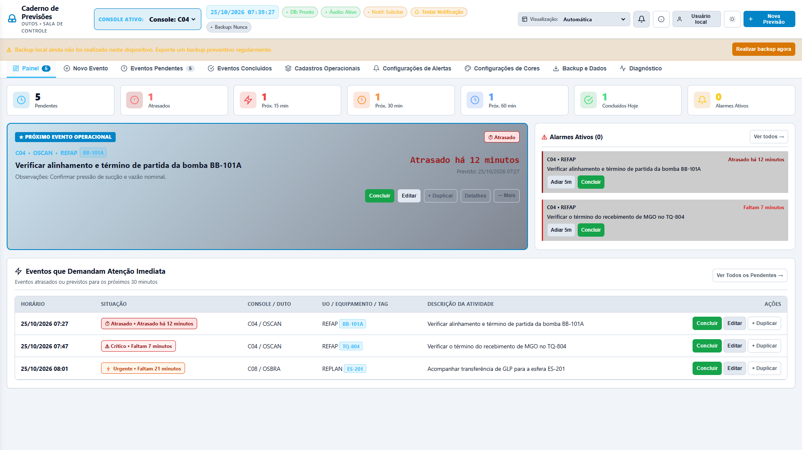
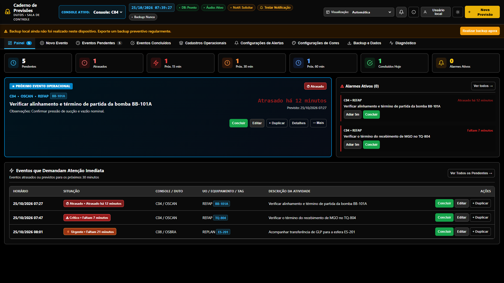
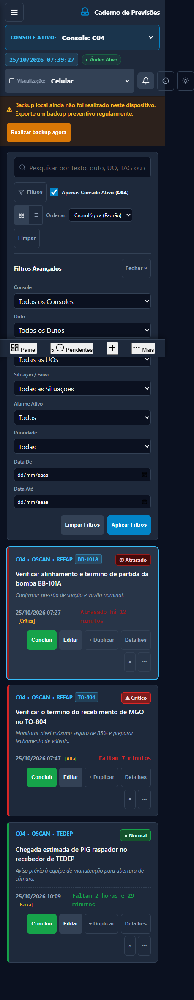
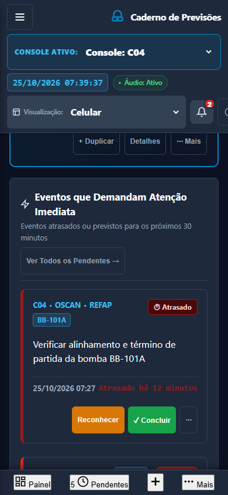
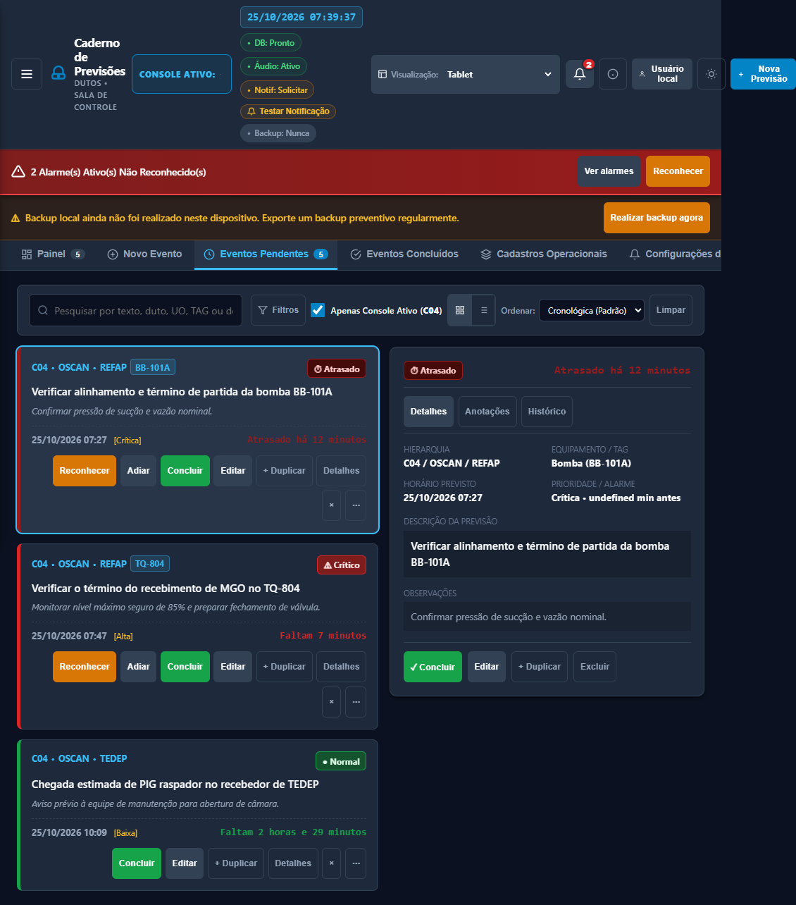
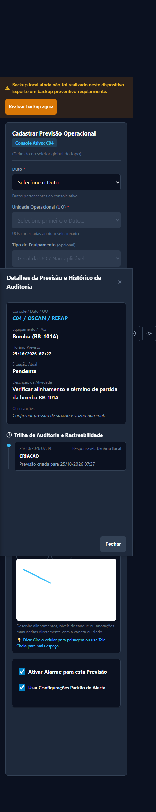

## Auditoria completa da interface gráfica

Caderno de Previsões Operacionais em Dutos | 25/10/2026 | Horário de Brasília | Revisão documental, visual, estática e de execução. Fontes da aplicação preservados; dados de teste pertencem a perfis temporários do navegador.

## 1. Parecer

A interface é parcialmente coerente com o documento e com as referências. Há uma base funcional reconhecível, mas a adaptação móvel/tablet não está concluída e a composição de monitores amplos não corresponde integralmente às pranchas. Há falhas de apresentação que alteram o significado operacional do que é exibido; portanto não se trata apenas de refinamento estético. Não recomendo considerar esta versão aprovada contra a especificação antes de corrigir os bloqueadores e repetir os critérios de aceite deste relatório.

O relatório registra 40 grupos de achados, 321 itens rastreáveis do DOCX, 22 elementos de comparação visual, 90 capturas e 198 medições de tela em 19 larguras. As contagens dos requisitos não equivalem a 321 obrigações únicas: 248 itens foram classificados como obrigações, 48 como recomendações e 25 como sínteses que repetem requisitos anteriores. Não foi atribuído percentual subjetivo de fidelidade.

| Prioridade | Interpretação | Grupos |
| --- | --- | --- |
| P0 | Ação inesperada, perda de dados ou execução de conteúdo pelo arquivo | 4 |
| P1 | Informação operacional incoerente ou ação essencial inacessível | 17 |
| P2 | Composição, acessibilidade e fluxo parcialmente implementados | 18 |
| P3 | Melhoria de escala e manutenção da experiência | 1 |

## 2. Materiais e método

O DOCX contém 520 parágrafos e 1 tabela. Foram extraídos 478 parágrafos não vazios, com marcadores P0000…P0519, além de 6 linhas da tabela. A cobertura preserva parágrafos normativos, exemplos, contexto e justificativas de inclusão/exclusão. O arquivo cobertura_paragrafos_docx.json permite localizar cada trecho; requisitos_extraidos.txt mantém a transcrição textual. Os três PDFs têm uma página cada e foram renderizados e examinados visualmente, sem presumir equivalência pelos nomes dos PNGs.

| Arquivo | Conteúdo avaliado |
| --- | --- |
| Designer.pdf | Seis fluxos de celular e dois de tablet: painel, pendentes, novo, alarme, filtros, drawer e lista/detalhe. |
| Designer (1).pdf | Controle Escuro, Profissional Claro e Industrial Alto Contraste; exemplos de painel, listas e formulário. |
| Designer (2).pdf | Monitor convencional, widescreen e ultrawide; regiões coordenadas, navegação lateral, contexto e ações. |
| Imagens adicionais | Designer (1).png e (2).png são duplicatas entre si; Designer (3).png e Designer.jpg mostram temas; Designer.jpeg é inteiramente branco. PDF e PNG com mesmo sufixo não são intercambiáveis. |

Wireframes são referências de comportamento, conforme o próprio DOCX. Foram cobrados hierarquia, composição, prioridade operacional e ergonomia; não foram cobrados pixel a pixel, carcaças de aparelhos, tipografia distorcida das imagens ou textos ilustrativos gerados. Os gráficos da prancha são divergências de referência visual, sem serem promovidos automaticamente a novas regras operacionais.

Execução: Microsoft Edge/Chromium 156.0.4314.42, Playwright, arquivo local file://, perfil temporário e timezone America/Sao_Paulo. Nove visões foram abertas nos perfis Celular Auto 390 ×844, Celular Manual 390 ×844, Tablet Auto 820 ×1180, Tablet Manual 1024 ×768 e Desktop Auto 1440 ×1000. Foram avaliadas ainda as larguras 320, 360, 390, 480, 600, 767, 768, 820, 1024, 1199, 1200, 1440, 1600, 1919, 1920, 2200, 2559, 2560, 3440 px; os sete valores de visualização foram persistidos e recarregados; os três temas foram capturados após estabilização das transições.

Para comparação determinística, o motor periódico foi pausado após um tick inicial; eventos de demonstração e alarmes foram criados apenas nas bases temporárias. Testes temporais avançam Date.now sem alterar o relógio do sistema. Não se deve interpretar relógio parado na captura como falha da aplicação. Capturas finais desativam animações durante a imagem para evitar estados transitórios de cor. Imagens full-page documentam página inteira; elementos sticky/fixed aparecem na posição de captura e devem ser lidos junto das medidas. A imagem de rolagem do banner é de viewport, para evidenciar a sobreposição real.

## 3. Resultado por tela

| Visão | Avaliação | Resultado |
| --- | --- | --- |
| Painel principal | Parcial com falhas críticas de coerência temporal | Métricas, Spotlight e urgentes existem; no Auto móvel a ordem segue desktop. Há contador de outro evento, classificação que pode ficar antiga e faixa de alarme sobreposta. Em tablet contador lateral 0; em wide/ultra faltam regiões da referência. |
| Nova previsão | Parcial | Seletores encadeados, campos nativos, ações salvar e desenho existem. Descrição de linha única, campos no tablet pequenos, formulário sem toda a separação de regiões e dependência de barras fixas ainda não validada com teclado físico móvel. |
| Eventos pendentes | Parcial | Pesquisa, ordenação, cartões, tabela e detalhes presentes. Filtros não viram sheet, excesso de ações e detalhe inicial vazio. Tabela preferida pode continuar no celular; há risco de filtros desatualizados. |
| Eventos concluídos | Parcial | Tabela de nove colunas foi corrigida e cards existem. Expansão ineficaz, identificação de controlador genérica e CSV de conclusão inválido; atalho Hoje não limita o período. |
| Cadastros operacionais | Parcial | Cinco tipos de cadastro, filtros ativo/inativo e criação inline presentes. Fluxo móvel/tablet segue hub e não lista→formulário/duas regiões; classes dos botões divergem; categoria pode ser perdida ao mudar modo. |
| Configurações de alertas | Parcial | Controles amplos e três temas existem, mas página não é organizada em todas as seções expansíveis; zeros mudam de valor e algumas preferências visuais não comandam renderização. |
| Configurações de cores | Parcial | Cards e cadeia existem, com validação de faixas. Edição não tem toda a prévia/organização prevista e mudanças temporais não garantem atualização dos cartões já exibidos. |
| Backup e dados | Não pronta para validação operacional | Downloads funcionam no Edge, mas prévia executa código, replace pode esvaziar base, merge pode regredir, demonstrativo apaga dados com sucesso enganoso e CSV tem dados inválidos. Importação móvel segue modal genérico. |
| Diagnóstico técnico | Parcial | Contagens e cópia existem. Tabela permanece densa, versão divergente e ausência de uso efetivo do registro de erros. Status não comprova alertas sob bloqueio/suspensão. |

## 4. Evidências de composição e responsividade

| Perfil | Viewport | Largura do conteúdo nas nove telas | Resultado |
| --- | --- | --- | --- |
| Celular automático | 390 px | 1077–1077 px | Extrapola página inteira |
| Celular manual | 390 px | 459–472 px | Extrapola página inteira |
| Tablet automático | 820 px | 1077–1077 px | Extrapola página inteira |
| Tablet manual | 1024 px | 1130–1130 px | Extrapola página inteira |
| Desktop automático | 1440 px | 1440–1440 px | Sem extrapolação global neste conjunto |

## 5. Temas, ergonomia e acessibilidade

Os três temas estão implementados e são distinguíveis. O Industrial aplica fundo preto, superfícies escuras, texto claro e botão primário amarelo/preto. Persistem cores fixas azuis e vermelho escuro no contador. A aprovação deve medir os pares reais de texto/fundo e ser complementada por ensaio de leitura e legibilidade em aparelhos físicos.

A classificação utiliza texto e ícone além de cor, aspecto positivo. Emulação prefers-reduced-motion produziu animationDuration 0 s nos cards e badges pulsantes. Por outro lado, a ordenação tem 32 px de altura e 12 px de fonte; descrição no tablet 46 px/14,4 px; há labels de métricas e auxiliares abaixo dos 14 px recomendados. O inventário de controles informa dimensões reais por perfil; checkboxes devem ser avaliados com sua label e área acionável, sem contar apenas o quadrado.

A inspeção encontra 34 controles visíveis ou condicionais sem associação de label, além de 2 auxiliares ocultos; 9 de 10 diálogos sem nome associado e 9 fechamentos sem nome explícito. Isso é inventário estático, com placeholders/title registrados separadamente, não certificação formal de acessibilidade. Testes de Tab confirmam foco atrás de modal e em drawer fechado fora da tela. Leitor de tela e teclado virtual físico permanecem pendentes.

## 6. Achados detalhados e critérios de aceite

## GUI-01 | P1 | Modo automático não aplica a composição de celular e tablet

Base: DOCX §§1.1–1.4: reorganizar automaticamente por espaço disponível, inclusive navegação inferior e lista/detalhe.

Resultado: Em 390 px o tier é mobile, porém data-layout-mode está ausente; app-nav continua flex e bottom nav none. Em 820 px ocorre o equivalente para tablet.

Causa identificada: applyResponsiveLayoutMode e handleViewportResize atribuem o tier automático somente para widescreen e ultrawide; CSS mobile/tablet exige o atributo.

Evidência: parts_js_ui.py:95,108,168; parts_css.py:1665,1823; metricas_navegador.json; celular_auto_viewDashboard.png; tablet_auto_viewDashboard.png | Classificação: Confirmado em execução

Critério de aceite: Auto deve ativar a composição adequada em 320–1199 px, inclusive após redimensionamento, sem depender de seleção manual.

## GUI-02 | P1 | Cabeçalho e controles extrapolam a largura disponível

Base: DOCX P0012, §§2.2 e 20: nenhuma rolagem horizontal da página inteira; cabeçalho compacto e console acessível.

Resultado: 390 px Auto: scrollWidth 1077 px; 390 px Celular:459–472 px; 820 px Auto:1077 px; 1024 px Tablet:1130 px. O cabeçalho móvel manual mede cerca de 227 px de altura e mantém ações fora da tela.

Causa identificada: Grupos flex e seletor de visualização preservam larguras/conteúdo de desktop; a composição não comprime ou redistribui todos os grupos.

Evidência: parts_css.py:349,1277,1681; metricas_navegador.json; celular_manual_viewDashboard.png | Classificação: Confirmado em execução

Critério de aceite: documentElement.scrollWidth deve ser igual à largura útil em todos os modos viáveis; console, sino, menu e nova previsão acessíveis sem deslocar a página inteira.

## GUI-03 | P1 | Barra inferior móvel usa classes incompatíveis com o CSS

Base: DOCX §2.3 e Designer.pdf: quatro destinos com ícone/rótulo e apenas um comando Novo em posição previsível.

Resultado: No manual Celular a barra aparece, mas seus botões têm aparência nativa branca e o Novo é um quadrado pequeno; no Auto nem aparece.

Causa identificada: HTML usa bottom-nav-item, bottom-nav-fab e bottom-nav-badge; CSS estiliza bottom-nav-btn, mobile-fab e bottom-badge.

Evidência: parts_html.py:1628; parts_css.py:1574,1608; celular_manual_viewDashboard.png; celular_manual_viewNewEvent.png | Classificação: Confirmado em execução

Critério de aceite: Unificar seletores; quatro destinos com estados ativo/foco, alvos de toque adequados, safe-area e sem botão concorrente.

## GUI-04 | P1 | Faixa persistente de alarmes fica atrás do cabeçalho

Base: DOCX §3.2: faixa sempre visível logo abaixo do cabeçalho enquanto houver triggered.

Resultado: Com dois alarmes e rolagem, cabeçalho ocupa y 0–227 px; faixa fica em y 52–152 px, dentro da área ocupada pelo cabeçalho. Há sobreposição objetiva.

Causa identificada: alarm-banner usa top:52 px fixo, apesar de cabeçalho móvel variável e camada superior.

Evidência: parts_css.py:1257; testes_estados.json:banner_scrolled; estado_banner_rolagem.png | Classificação: Confirmado em execução

Critério de aceite: Deslocamento da faixa deve acompanhar a altura real do cabeçalho; reconhecimento e quantidade devem permanecer visíveis em retrato e paisagem.

## GUI-05 | P1 | Filtros móveis não abrem como painel inferior

Base: DOCX §4.1 e Designer.pdf: painel inferior com rolagem própria, Limpar/Aplicar e contagem de filtros.

Resultado: Execução: class toolbar-filters, position static, height aproximadamente 665 px; o painel permanece no fluxo e pode ultrapassar a altura útil.

Causa identificada: CSS depende de #filterDrawer.active-sheet; JS altera somente style.display e não adiciona active-sheet.

Evidência: parts_js_ui.py:1530; parts_css.py:1727; testes_fluxos.json:filter_sheet; celular_manual_modal_filtros.png | Classificação: Confirmado em execução

Critério de aceite: Abrir sheet limitado ao viewport, manter rodapé acessível, foco contido e fechamento explícito; considerar Apenas Console Ativo na contagem.

## GUI-06 | P1 | Spotlight mistura descrição de um evento com tempo de outro

Base: DOCX §§1.3,3.3,14: descrição, hierarquia, previsto e contador devem corresponder ao mesmo evento do console ativo.

Resultado: Após pesquisar PIG em Pendentes e voltar ao Painel, a descrição continua na bomba atrasada 12 min, mas updateLiveTimers troca o contador para Faltam 2 h 29 min, referente ao PIG.

Causa identificada: renderDashboard seleciona spotlightTarget; updateLiveTimers usa activePendingEvents[0], uma lista filtrada e independente.

Evidência: parts_js_ui.py:1738,2246; testes_fluxos.json:spotlight_before/after; dashboard_contador_evento_incorreto.png | Classificação: Confirmado em execução

Critério de aceite: Persistir ID/timestamp do destaque e usar a mesma origem em renderização e atualização; filtros da lista não devem alterar seu contador.

## GUI-07 | P1 | Contador do modal de alarme fica congelado

Base: DOCX §7 e Designer.pdf: alarme exibe contador temporal destacado e atual.

Resultado: Avanço simulado de 90 s: texto do modal permanece igual, enquanto formatTimeRemaining já retorna outro atraso.

Causa identificada: alarmModalCountdown é preenchido apenas em showAlarmModal; updateLiveTimers não o inclui.

Evidência: parts_js_ui.py:3446,2236; testes_estados.json:alarm_frozen; estado_alarme_contador_congelado.png | Classificação: Confirmado em execução

Critério de aceite: Modal aberto deve atualizar seu próprio evento ao menos na cadência do motor, inclusive após suspensão/retorno.

## GUI-08 | P1 | Criticidade visual e métricas podem ficar desatualizadas

Base: DOCX §21: nome da faixa, cor e texto temporal coerentes.

Resultado: Evento a 16 min é Urgente; após avanço simulado de 2 min, contador muda mas badge continua Urgente, embora classificação calculada seja Crítico. Métricas dependem de nova renderização.

Causa identificada: Tick atualiza textos temporais; cores, classes, filtros temporais e indicadores só são recalculados por renderizações ocasionais.

Evidência: parts_js_ui.py:2236; parts_js_service.py:1268; testes_integridade_visual.json:band_stale | Classificação: Confirmado em execução

Critério de aceite: Ao cruzar cada limite, atualizar classe, cor, nome, contagens e inclusão na lista urgente sem exigir interação ou alarme.

## GUI-09 | P1 | Antecedência e volume zero não são respeitados

Base: Formulário admite antecedência 0 e volume 0%; comportamento deve corresponder ao valor exibido.

Resultado: Com antecedência global 0, evento a 10 min disparou. Com volume 0, Audio.play recebeu 80. A tela permite uma configuração que não é executada.

Causa identificada: Uso de valor || padrão no salvamento e no motor transforma zero em 15 ou 80.

Evidência: parts_js_ui.py:1148; parts_js_service.py:1297,1367; testes_integridade_visual.json:zero_lead/zero_volume | Classificação: Confirmado em execução

Critério de aceite: Distinguir ausência de zero; salvar/recarregar e disparar com 0 sem substituição, mantendo checkbox de habilitação separado.

## GUI-10 | P0 | Cancelar confirmação deixa a ação antiga armada

Base: Cancelar/fechar um diálogo deve descartar integralmente a ação em análise.

Resultado: AbrirA, cancelar, abrir B, confirmar resulta em ações[A, B]. Também há padrão semelhante em dependências/importação.

Causa identificada: Listener do botão confirmar só é removido na confirmação; fechar não remove closures anteriores.

Evidência: parts_js_ui.py:3598,3613,3629; testes_fluxos.json:confirmation_cancel | Classificação: Confirmado em execução

Critério de aceite: Uma única ação atual por diálogo; cancelar, Escape e backdrop devem remover callbacks; confirmar B nunca executa A.

## GUI-11 | P1 | Anotação salva não aparece no modal de detalhes

Base: DOCX §24 P0479 e §§6,15: desenho salvo visível nos detalhes.

Resultado: PNG existe; img display inline, container interno block, mas ancestral detailsModalDrawingBox permanece display:none. Imagem não tem retângulo visível.

Causa identificada: JS escolhe detailsStylusContainer e mostra somente o filho, sem exibir o pai oculto.

Evidência: parts_html.py:1843; parts_js_ui.py:3542; testes_fluxos.json:drawing_details; detalhes_com_desenho_oculto.png | Classificação: Confirmado em execução

Critério de aceite: Um único container visível controlado de forma consistente; abrir eventos com e sem desenho alternadamente não deixa imagem residual ou oculta.

## GUI-12 | P1 | Detalhe inicial de tablet/ultrawide abre sem conteúdo

Base: Designer.pdf e DOCX §15: seleção deve mostrar hierarquia, programação, descrição e ações.

Resultado: Inicialmente tab=details, painel mostra badge, contador, abas e botões, mas não os dados. Após clicar no evento, tab=detalhes e conteúdo aparece.

Causa identificada: Estado inicial usa chave inglesa details; renderPendingDetailPane compara detalhes, anotacoes, historico.

Evidência: parts_js_ui.py:13,2110,2127; testes_estados.json:detail_default/detail_clicked; estado_detalhe_tablet_inicial.png | Classificação: Confirmado em execução

Critério de aceite: Normalizar chaves; seleção inicial e troca de modos devem manter aba/dados; teste sem clique adicional.

## GUI-13 | P1 | Resumo do alarme mostra undefined min antes

Base: DOCX §15: detalhe selecionado apresenta programação e alarmes legíveis.

Resultado: Após corrigir a seleção por clique, o detalhe mostra Crítica • undefined min antes.

Causa identificada: Renderizador usa ev.leadTimeMinutes; modelo persiste alarmMinutesBefore e configurações globais podem definir outro valor efetivo.

Evidência: parts_js_ui.py:2144; parts_js_service.py:574; testes_estados.json:detail_clicked; estado_detalhe_tablet_apos_clique.png | Classificação: Confirmado em execução

Critério de aceite: Mostrar antecedência efetiva correta para configuração padrão/específica; nenhum undefined/NaN na interface.

## GUI-14 | P1 | Contador lateral de alarmes permanece zero

Base: DOCX §14 e referências: quantidade deve corresponder aos alarmes apresentados.

Resultado: Dois eventos triggered: cabeçalho 2, métrica 2, banner 2, mas painel lateral 0.

Causa identificada: HTML usa tabletAlarmsCount; JS procura badgeTabletAlarmsCount inexistente.

Evidência: parts_html.py:370; parts_js_ui.py:1709; testes_estados.json:alarm_badges; estado_alarmes_ativos_tablet.png | Classificação: Confirmado em execução

Critério de aceite: Vincular o ID correto e definir se painel conta triggered ou também críticos/atrasados; título/lista/contagem coerentes.

## GUI-15 | P2 | Cartões de concluídos não recolhem nem expandem

Base: DOCX §8: cartões compactos expansíveis no celular.

Resultado: Antes/depois do clique, detalhes continuam display:block e mesma altura; muda somente classe expanded.

Causa identificada: CSS estiliza completed-card-extra; HTML dinâmico usa completed-card-details.

Evidência: parts_css.py:1455; parts_js_ui.py:2371; testes_estados.json:completed_expansion; estado_concluidos_expansao_ineficaz.png | Classificação: Confirmado em execução

Critério de aceite: Classe única; expansão por clique e teclado, aria-expanded e ação destrutiva protegida.

## GUI-16 | P0 | Carregar demonstração esvazia a base e anuncia sucesso

Base: Botão deve carregar os exemplos anunciados e descrever claramente qualquer substituição.

Resultado: Clique real+confirmação:6 eventos/4 UOs passaram a 0/0; toast diz Massa de dados de demonstração carregada com sucesso.

Causa identificada: Handler chama clearAllData, mas não chama loadDemoData antes de informar sucesso.

Evidência: parts_js_ui.py:1346; testes_estados.json:demo_before/demo_after; estado_botao_demo_base_esvaziada.png | Classificação: Confirmado em execução

Critério de aceite: Após confirmar deve existir massa anunciada; se substituir dados, prévia e aviso devem dizer isso explicitamente, com recuperação verificável.

## GUI-17 | P0 | Prévia de backup executa código fornecido pelo arquivo

Base: DOCX §§11,23: prévia de arquivo deve ser apresentação segura antes da importação.

Resultado: Um exportedAt inválido contendo um elemento com handler executou marcador JavaScript ao abrir o resumo, antes de confirmar.

Causa identificada: Formatador retorna texto inválido original e showImportSummaryModal insere o valor sem escape em innerHTML.

Evidência: parts_js_ui.py:3633; parts_js_core.py:111; testes_integridade_visual.json:backup_summary_script_execution | Classificação: Confirmado em execução

Critério de aceite: Tratar texto como texto; validar esquema/formatos e URLs de imagem/IDs; arquivo inválido nunca cria atributos executáveis.

## GUI-18 | P0 | Substituição de backup pode deixar a base vazia

Base: DOCX §§11,23 e preservação de integridade: validar antes de alterar e recuperar em falha.

Resultado: Backup com consoles:[{}] passa pela validação; replace limpa coleções e falha ao inserir chave ausente. No teste 13 consoles viraram 0.

Causa identificada: Validação superficial; várias transações independentes após limpeza. Download preventivo não fornece rollback transacional.

Evidência: parts_js_service.py:1473,1504; testes_integridade_visual.json:replace_invalid (download preventivo substituído por stub apenas no teste) | Classificação: Confirmado em execução

Critério de aceite: Validar todos registros/relações antes da confirmação final; substituição atômica; falha mantém base anterior íntegra.

## GUI-19 | P1 | Mesclagem pode sobrescrever dado novo por antigo

Base: Promessa da interface/documentação: preservar registros mais recentes sem duplicar.

Resultado: Registro 2026 versão 2 foi substituído por registro 2020 versão 2.

Causa identificada: Merge compara apenas version com >=; updatedAt não participa e regras de negócio não são revalidadas.

Evidência: parts_js_service.py:1535; testes_integridade_visual.json:merge_old | Classificação: Confirmado em execução

Critério de aceite: Política de conflito explícita e prévia dos conflitos; igualdade de versão não autoriza regressão silenciosa.

## GUI-20 | P1 | CSV apresenta data e hora de conclusão inválidas

Base: DOCX §11 e tela Backup: formato brasileiro e arquivo utilizável.

Resultado: Download real contém 25 T10:...Z/10/2026 e hora 2026-. Entrada 2026-10-25 T15:30 Z produz formatos inválidos. Strings iniciadas por= são mantidas como fórmulas potenciais.

Causa identificada: formatDate divide ISO por hífen; formatTime corta os cinco primeiros caracteres de qualquer string com dois-pontos; escapeCSV só protege delimitadores.

Evidência: parts_js_core.py:83,98,177; parts_js_service.py:1619; teste_previsoes_concluidas.csv; testes_integridade_visual.json:formats | Classificação: Confirmado em execução

Critério de aceite: Tratar Date/ISO/data simples separadamente; fuso local consistente e política de texto para células de origem livre.

## GUI-21 | P1 | Modais não recebem nem contêm o foco

Base: DOCX §19: teclado físico funcional, foco devolvido ao acionador e ações críticas protegidas.

Resultado: Ao abrir conclusão, foco permanece no botão Filtros atrás do diálogo; Tab vai ao checkbox de console no fundo; Escape fecha, sem retornar ao acionador original.

Causa identificada: Abertura/fechamento só altera classes; não há controlador comum de foco, inert ou contenção de Tab.

Evidência: parts_js_ui.py:3321,3460; testes_estados.json:focus_open/focus_tab/focus_escape | Classificação: Confirmado em execução

Critério de aceite: Foco inicial no diálogo, fundo inerte, Tab circular, Escape controlado e retorno ao acionador; ensaio com leitor de tela.

## GUI-22 | P1 | Menu fechado continua recebendo Tab fora da tela

Base: DOCX §§2.3,19,20: navegação acessível e controles alcançáveis.

Resultado: Sequência real de Tab alcançou btnCloseMobileDrawer e todos os links do drawer fechado com coordenadas negativas.

Causa identificada: Menu fechado só recebe transform translateX; permanece exibido/focável; botão não anuncia expansão.

Evidência: parts_css.py:417; parts_js_ui.py:341; testes_estados.json:tab_sequence_drawer_closed | Classificação: Confirmado em execução

Critério de aceite: Menu fechado deve sair da árvore de interação; aberto deve controlar foco e anunciar estado.

## GUI-23 | P2 | Controles e diálogos sem nomes acessíveis suficientes

Base: DOCX §§5.1,19,20: campos e ícones com nome acessível e relação inequívoca.

Resultado: Inventário encontrou 36 controles sem label associado; 2 são auxiliares explicitamente ocultos. Nove dos dez diálogos não têm nome associado; nove fechamentos mostram só×.

Causa identificada: Labels adjacentes sem for; placeholders/símbolos substituem relações semânticas; aria-modal não nomeia diálogo.

Evidência: dados/inspecao_estatica.json; dados/analise_acessibilidade.md; parts_html.py:1701–1959 | Classificação: Confirmado por inspeção estática; inventário completo disponível

Critério de aceite: Associar label/for ou aria-label/labelledby; nomes de ícones/fechamentos; validar leitura por tecnologia assistiva, sem supor que inventário sozinho certifica conformidade.

## GUI-24 | P2 | Campos, ações e textos ainda ficam menores que a orientação do DOCX

Base: DOCX §20 recomenda alvos~44 px, campos 48 px, principal 16 px, auxiliar 14 px.

Resultado: Ordenação medida 150 ×32 px, fonte 12 px em celular/tablet; descrição tablet 46 px/14,4 px; labels de métricas~11,5 px; fechar modal 36 ×36 px. Descrição mobile 48 px/16 px é positiva.

Causa identificada: Estilos inline pequenos prevalecem sobre regras responsivas e vários controles não usam classebtn.

Evidência: metricas_navegador.json:controls; parts_css.py:749,1080; parts_html.py:525,940; analise_acessibilidade.md | Classificação: Confirmado em execução

Critério de aceite: Medir área realmente clicável, considerando labels decheckbox; adequar controles e hierarquia tipográfica sem encolher conteúdo essencial.

## GUI-25 | P2 | Descrição permanece de uma linha e formulário não segue toda a hierarquia móvel

Base: DOCX §5.3 exige descrição multiline; §§5.1,16 organizam localização/programação/atividade/alarme em blocos.

Resultado: Descrição é INPUT type=text. Tablet não separa claramente localização e programação em duas regiões. No celular há barra de salvar, mas ainda excesso de ações e campos longos.

Causa identificada: Formulário reutiliza grade genérica de desktop, com descrição input e grupos extensos.

Evidência: parts_html.py:499; parts_css.py:593; testes_fluxos.json:description_type; celular_manual_viewNewEvent.png; tablet_manual_viewNewEvent.png | Classificação: Confirmado em execução

Critério de aceite: Textarea, grupos lógicos coerentes, dois comandos de salvamento legíveis, campos preservados e política explícita paraEnter.

## GUI-26 | P2 | Teclado virtual e áreas seguras têm cobertura incompleta

Base: DOCX §§19,22: barras não cobrem campo ativo; teclado apropriado; avançar não salva por acidente.

Resultado: Há tipos nativos date/time/number e safe-area na barra inferior, mas não há tratamento explícito de visualViewport, focusin, scrollIntoView, inputmode/enterkeyhint ou submissão implícita.

Causa identificada: Barras sticky/fixas dependem da geometria do viewport; apenas presença de CSS não demonstra comportamento com teclado.

Evidência: parts_html.py; parts_js_ui.py; analise_acessibilidade.md; screenshots nova previsão | Classificação: Lacuna estática confirmada; efeito em teclado virtual não verificado

Critério de aceite: Testar Android/iOS com teclado aberto, retrato/paisagem/zoom; campo e ação principal visíveis. Não afirmar falha em todos aparelhos sem ensaio.

## GUI-27 | P2 | Lousa preserva os bytes, mas sua proporção visual muda

Base: DOCX §§6,17: proporção preservada, prioridade stylus, ferramentas acessíveis, rotação sem perda.

Resultado: Texto e PNG foram preservados na rotação simulada. Porém canvasbitmap 600 ×220 apareceu 293 ×180 e depois 747 ×180; mesmos pixels sofrem escalas distintas. Ferramentas têm positionstatic.

Causa identificada: Tamanho de buffer fixo e altura CSS independente da largura; fullscreen não recalcula buffer/proporção.

Evidência: parts_js_ui.py:410; parts_html.py:542; testes_fluxos.json:canvas_before/rotation/canvas_fullscreen; lousa_tela_cheia_paisagem.png | Classificação: Confirmado em execução

Critério de aceite: Separar coordenadas lógicas e resolução de apresentação; preservar aspecto ou reamostrar sem deformar; verificar stylus, palma, pressão e nitidez em aparelho físico.

## GUI-28 | P2 | Categoria de cadastro é perdida ao reaplicar visualização

Base: DOCX §1.2: mudança de layout preserva posição lógica e seleção.

Resultado: SelecionarTAGs e reaplicarTablet troca categoria paraConsoles.

Causa identificada: switchCadastrosCategory grava activeCadastrosCategory; applyResponsiveLayoutMode lê currentCadastrosCategory, que permanececonsoles.

Evidência: parts_js_ui.py:128,2435; testes_estados.json:category_before/category_after | Classificação: Confirmado em execução

Critério de aceite: Estado único da categoria; alternar modo/rotação não troca contexto nem apaga edição em andamento.

## GUI-29 | P2 | Atalhos das métricas não correspondem às listas abertas

Base: DOCX §3.4: cada métrica funciona como filtro/atalho coerente.

Resultado: Cards 15/30/60 min apenas navegam; Alarmes não reconhecidos aplica hasAlarm, que inclui programados/reconhecidos; Concluídos hoje não limita o dia; filtros anteriores podem continuar ativos.

Causa identificada: Handler só diferencia completed, overdue e unacknowledged; não define estado completo do filtro de destino.

Evidência: parts_js_ui.py:761; parts_html.py:270; analise_acessibilidade.md | Classificação: Confirmado por inspeção do handler

Critério de aceite: Lista aberta deve corresponder exatamente à contagem, com filtro explícito e sem restos de busca anterior; usar controles nativos acessíveis por teclado.

## GUI-30 | P2 | Hub de cadastros não entrega o fluxo hierárquico da referência

Base: DOCX §§9,18: celular categoria→lista→formulário; tablet duas regiões.

Resultado: Categorias filtram seções, mas lista e formulário continuam no mesmo hub vertical. Botões de categoria aparecem sem a aparência definida para cad-cat-btn.

Causa identificada: HTML cadastros-category-btn diverge de CSS cad-cat-btn; gridTablet é uma coluna e categorias não formam rail lateral.

Evidência: parts_html.py:895; parts_css.py:1474,1849; celular_manual_viewCadastros.png; tablet_manual_viewCadastros.png | Classificação: Confirmado em execução

Critério de aceite: Coerência entre classes e apresentação; categoria/lista/formulário claros e estado de edição preservado.

## GUI-31 | P2 | Desktop convencional não possui navegação lateral fixa

Base: DOCX §1.2 P0023 e Designer (2).pdf: navegação lateral, indicadores, destaque e lista.

Resultado: ModoConvencional mantémapp-navhorizontal; não existe shell lateral persistente. Há boa tabela e métricas, mas composição diverge.

Causa identificada: Não há implementação de sidebar desktop; modo apenas mantém apresentação base.

Evidência: parts_html.py:209; modo_conventional_viewDashboard.png; Designer (2).pdf página 1 | Classificação: Confirmado em execução

Critério de aceite: Definir shell convencional conforme referência ou registrar formalmente exceção; não avaliar somente pela existência do seletor.

## GUI-32 | P2 | Widescreen e ultrawide ampliam o espaço sem compor todas as regiões

Base: Designer (2).pdf e DOCX §§1.1–1.2: lista, detalhe, métricas/contexto e ações em regiões coordenadas.

Resultado: Wide mostra destaque+alarmes e tabela abaixo. Ultra estica a composição; Pendentes tem lista/detalhe, mas não reúnetodas regiões. Gráficos e rail de ações da prancha não existem.

Causa identificada: CSS amplia max-width e algumas grids; não há componentes para todos os painéis da referência.

Evidência: parts_css.py:1869; modo_widescreen_viewDashboard.png; modo_ultrawide_viewDashboard.png; matriz_visual.json | Classificação: Confirmado em execução

Critério de aceite: Aproveitar área para contexto coordenado e listas legíveis, evitando colunas de texto excessivamente largas. Gráficos são divergência de referência, não requisito operacional autônomo inferido.

## GUI-33 | P2 | Temas existem, mas elementos críticos ainda escapam dos tokens

Base: Designer (1).pdf: identidade coerente dos três temas, com prioridade à leitura da criticidade.

Resultado: Após estabilizar transições, Industrial tem botão amarelo/texto preto e navegação clara, corretamente. Persistem azul fixo do Spotlight/header/abaativa e contadoratrasado#991 b 1 b em superfícies escuras. Claro mantém gradiente destacado e texto auxiliar pequeno.

Causa identificada: Muitos estilos inline/hexadecimais em lugar dos tokens; classe de evento também fornece cor sem adequação ao fundo.

Evidência: parts_css.py:115,387; parts_js_ui.py:1756; testes_estados.json:theme_colors; tema_industrial_viewDashboard.png; tema_light_viewDashboard.png | Classificação: Confirmado em execução

Critério de aceite: Revisar texto/fundo real por componente e estado; medir contraste e validar luminosidade física. Não declarar tema inteiro inválido nem copiar literalmente cores de imagem gerada.

## GUI-34 | P2 | Configurações e cores não seguem completamente a simplificação móvel

Base: DOCX §§10–11: grupos expansíveis e edição de faixas adequada ao celular.

Resultado: Configurações de alertas permanecem longa página; faixas têmcards, mas editor continua na mesma visão e cadeia só reflete dados já salvos. Highlight/pulsing são salvos, mas não governam os renderizadores inspecionados.

Causa identificada: Controles presentes sem vinculação integral à apresentação; ausência de composição expansível de todos os grupos.

Evidência: parts_js_ui.py:1153,3108; partes HTML/CSS; celular_manual_viewConfigAlerts.png; celular_manual_viewConfigColors.png; analise_docx.md | Classificação: Confirmado em execução

Critério de aceite: Grupos claros, preview de edição e opção visual realmente respeitada; movimento reduzido deve continuar funcionando independentemente da preferência salva.

## GUI-35 | P2 | Listas de filtros podem manter cadastros antigos

Base: Seletores devem refletir criação, edição, inativação e importação de cadastros.

Resultado: populateFilterDropdowns só preenche se options.length<=1. Após primeiro preenchimento, novos registros/nomes podem não aparecer até recarregar.

Causa identificada: Cache implícito baseado no número de opções, sem invalidação.

Evidência: parts_js_ui.py:2256; analise estática dos seletores | Classificação: Confirmado por inspeção da condição; cenário completo de alteração requer regressão

Critério de aceite: Repopular com preservação da seleção válida após cada alteração/importação; não deixar itens removidos nem impedir selecionar novos registros.

## GUI-36 | P2 | Diagnóstico e avisos não garantem refletir toda a situação real

Base: DOCX §§12,23: status compreensível, limitações do navegador e dados locais explícitos.

Resultado: Há statusmodal, avisobackup e documentação offline, positivos. Diagnóstico segue tabela densa; relatório declara v1.0.0 versus UIv1.1.0; logError não é usado nos fluxos inspecionados. Lembrete usa 7 dias fixos apesar da chave configurável.

Causa identificada: Identificação de versão duplicada; tratamento de erro no console sem alimentar coleção; prazo hardcoded.

Evidência: parts_js_ui.py:228,3296; parts_js_core.py:648; celular_manual_viewDiagnostic.png; analise_docx.md | Classificação: Confirmado em execução

Critério de aceite: Versão centralizada, erros úteis persistidos, lista móvel legível e período efetivo coerente com configuração; avisos não prometem garantia de alarme em segundo plano.

## GUI-37 | P2 | Ações contextuais e identificação do controlador ficam incompletas

Base: DOCX §§3.3,4.2,8: contexto claro e histórico confiável.

Resultado: Folha de ações deixa subtítulo--. Concluídos usa completedBy||createdBy||Usuário local, mas conclusão não grava esses campos, portanto pode apresentar atribuição genérica em lugar do operador do histórico.

Causa identificada: Markup auxiliar não é preenchido; renderizador espera propriedades que o modelo não persiste.

Evidência: parts_html.py:1950; parts_js_ui.py:2205,2353; parts_js_service.py:622; celular_manual_modal_acoes.png | Classificação: Confirmado em execução

Critério de aceite: Contextualizar evento no sheet; mostrar responsável real ou declarar ausência, nunca inferir identidade a partir de fallback genérico.

## GUI-38 | P2 | Referências documentais têm ambiguidades internas

Base: Uma especificação coerente deve definir composição e prioridade sem leituras conflitantes.

Resultado: Tabela inicial:desktop>1024 px com navegaçãohorizontal; §1.4:tablet até 1199 px; §1.2 e PDF:desktoplateral. Pranchaultrawide tem resolução ilustrativa inconsistente com razão 32:9.

Causa identificada: Versões incrementais do documento e rótulos de mockup não foram harmonizados.

Evidência: DOCX tabela 0/P0023/P0032; Designer (2).pdf página 1; inventario_referencias.json | Classificação: Confirmado nas referências; decisão de produto pendente

Critério de aceite: Consolidar critério por conteúdo e composição. Não tratar a diferença isolada 1600 vs 1920 como falha mandatória:breakpoints são explicitamente recomendações.

## GUI-39 | P3 | Lista grande renderiza cartões e tabela simultaneamente

Base: Continuidade de operação e navegação legível com histórico/pendências crescentes.

Resultado: Teste sintético 503 eventos:503 cards e 503 linhas criados, embora um modo fique oculto; tempo de renderização registrado no JSON. Não há paginação/virtualização.

Causa identificada: renderPendingEvents monta integralmente duas apresentações com getAll.

Evidência: parts_js_ui.py:1876,2057; testes_estados.json:render_500 | Classificação: Confirmado em execução

Critério de aceite: Definir volume esperado; medir em tablet real; renderizar apresentação necessária e limitar lotes se houver degradação. Tempo headless desta máquina não é benchmark de aparelhos.

## GUI-40 | P2 | Fechamento genérico e ações destrutivas exigem revisão de interação

Base: DOCX §§19–20: evitar fechamento acidental e separar ações destrutivas das frequentes.

Resultado: Backdrop fecha qualquermodal; Escape remove todos os overlays ativos. Excluir continua ao lado de ações comuns em várioscards/linhas. Adiar 5 m abre seletor em vez de aplicar 5 min; input 1–1440 não passa por checkValidity.

Causa identificada: Controlador de modal genérico sem política poração; ações replicadas em templates distintos.

Evidência: parts_js_ui.py:3321,3356,1729,2048; analise_acessibilidade.md; celular_manual_modal_adiamento.png | Classificação: Confirmado em execução

Critério de aceite: Política explícita por diálogo, proteção durante escrita, ações destrutivas separadas e limites de adiamento validados; texto do comando deve descrever seu efeito.

## 7. Modais, estados e ações conferidos

Foram abertos os dez diálogos: alarme, adiamento, conclusão, reabertura, detalhes, confirmação, dependências, importação, ações contextuais eStatus. Também foram capturadosdrawer, filtros, lousa em tela cheia, alarmes triggered, estado vazio, texto longo, desenho salvo invisível e detalhe antes/depois de selecionar. Presença e abertura não significam aprovação:os achados especificam foco, contador, fechamento e geometria.

## 8. As doze correções obrigatórias da seção 24

| Origem | Correção | Situação | Evidência |
| --- | --- | --- | --- |
| P0470 | Unificar .open e .active no drawer e no overlay. | aderente | Drawer e overlay adicionam/removem open e active conjuntamente; CSS aceita ambas. |
| P0471 | Manter somente um FAB ou usar a navegação inferior. | aderente | FABs ocultos; barra inferior com Novo. |
| P0472 | Corrigir a variável --bg-surface-elevated para --bg-elevated. | aderente | Usos atuais empregam bg-elevated; variável legada permanece definida nos três temas como valor equivalente. Correção funcional atende ao requisito; manter compatibilidade não é falha. |
| P0473 | Atualizar os badges do drawer mobile. | aderente | Todos badges drawer/mobile são atualizados no renderDashboard. |
| P0474 | Vincular corretamente os botões de backup e exportação. | aderente | Botões backup/CSV vinculados por listeners e aliases; validar downloads no navegador-alvo. |
| P0475 | Corrigir exportCSV('concluido') para exportCSV('completed'). | aderente | Chamada continua concluido, mas serviço normaliza para completed. Correção funcional equivalente, não literal. |
| P0476 | Harmonizar os valores do filtro de pontualidade. | aderente | Handlers aceitam antecedencia, atraso e noprazo usados no HTML. Tolerância <=1 min para rótulo Exato no Horário deve ser esclarecida. |
| P0477 | Adicionar ao HTML os filtros de registros ativos e inativos. | aderente | Cinco filtros ativos/inativos presentes. |
| P0478 | Normalizar as classes das faixas, por exemplo, range_critico para critico. | aderente | CSS aceita chaves range_* e nomes normalizados. Equivalência funcional; não exige remover ids persistidos. |
| P0479 | Unificar o container de desenho do modal de detalhes. | nao_aderente | Pai detailsModalDrawingBox está display:none. JS seleciona filho detailsStylusContainer e mostra somente filho; anotação continua invisível. |
| P0480 | Corrigir a quantidade de colunas do histórico de concluídos. | aderente | Nove cabeçalhos correspondem a nove td renderizadas. |
| P0481 | Remover referências a elementos inexistentes, como #labelActiveConsoleFilter, ou criar os elementos necessários. | aderente | Elemento labelActiveConsoleFilter criado e atualizado. |

Onze correções têm equivalência funcional no código; uma não está resolvida:desenho de detalhes. Essa contagem é restrita às 12 correções preexistentes, não à prontidão da interface. Definir aliasCSS é solução funcional válida, assim como normalizar concluido→completed no serviço. A regra de um únicoNovo está presente, mas o estilo da barra inferior continua defeituoso.

## 9. Resultados positivos e limites

Confirmados:mesmo HTML e IndexedDB; 372 IDs únicos; IDs do fonte eindex coincidentes; seletores encadeados com aria-live; três temas; sete modos persistidos após reload; quatro downloads reais pelo Edge(JSON, CSV pendentes, CSV concluídos, CSV cadastros); movimento reduzido; preservação de texto ePNG na rotação simulada; abertura dasnove visões sem erroJavaScript não tratado no ensaio. O conteúdo do CSV concluídos, apesar de baixar, está incorreto.

O ensaio sintético de 503 pendentes criou 503 cards e 503 linhas de tabela; tempo observado nesta execução:355 ms. Isso demonstra duplicação de apresentação, sem provar desempenho aceitável em tablet. Não se mediramRAM, CPU contínua, consumo de bateria ou funcionamento prolongado.

Pendências obrigatórias de homologação:AndroidChrome, iOSSafari, dispositivo com caneta e palma reais, pressão e precisão, luz solar, leitor de tela, zoom de sistema/200%, teclado virtual, áreas seguras de aparelhos, navegador em segundo plano, tela bloqueada, suspensão do computador, permissões reais de notificação, saída sonora física e múltiplas abas. O ensaio não afirma compatibilidade integral com esses cenários. Emular viewport não emula o sistema operacional móvel.

## 10. Ordem de correção e regressão

| Etapa | Trabalho | Condição para avançar |
| --- | --- | --- |
| 1 | P0:cancelamento, prévia/importação, demonstração | Nenhuma ação cancelada executa; nenhum arquivo executa código; falha não altera base anterior. |
| 2 | P1:contador único, modal, classificação, zeros, desenho, detalhes, badge | Descrição/tempo/estado correspondem ao mesmo evento; UI reflete o banco e as preferências. |
| 3 | Shell móvel/tablet e filtros | Sem overflow global; header / nav / sheet/ações críticas visíveis em 19 larguras e nas rotações. |
| 4 | Acessibilidade e formulários | Fluxo teclado completo; nomes acessíveis; alvos/fontes conforme orientação; ensaio com teclado virtual. |
| 5 | Desktop amplo e acabamento dos temas | Composição validada contra cadaPDF; cores medidas; regiões necessárias presentes. |
| 6 | Homologação física e volume esperado | Aceites executados em aparelhos-alvo, com evidência por browser, orientação e estado. |

## 11. Como consultar os registros

RELATORIO_INTERFACE.html reúne o texto integral, a matriz DOCX completa, a matriz visual e a galeria das 90 capturas com busca/filtro locais. RELATORIO_INTERFACE.docx inclui o relatório, figuras selecionadas e as duas matrizes completas. RELATORIO_INTERFACE.md mantém versão textual. MATRIZ_REQUISITOS.csv, MATRIZ_VISUAL.csv eACHADOS_PRIORIZADOS.csv permitem filtrar e priorizar em planilha. A pasta dados contém JSONs de medições, fluxos, estados, inventário ehashes; scripts reproduz a auditoria sem editar a aplicação. Downloads de teste são massa fictícia criada no perfil temporário.

As classificações da matriz DOCX são predominantemente estáticas; os achados GUI-01…GUI-40 e os JSONs de testes fornecem validação de execução e prevalecem em caso de diferença. Um requisito pode ter estrutura presente e falhar noAuto ou em outra parte do fluxo; por isso não se deve usar uma linhaaderente como aprovação transversal da funcionalidade.

## Apêndice A — Matriz integral do DOCX

| ID / natureza | Requisito | Situação / evidência / observação |
| --- | --- | --- |
| DOCX-P0001 / obrigacao | A versão para tablets e celulares deve preservar integralmente as regras operacionais, alarmes, auditoria, funcionamento offline e integridade cadastral da aplicação desktop. A adaptação deve ocorrer principalmente na apresentação, navegação e distribuição dos componentes, evitando transformar a interface móvel em uma simples redução proporcional da versão para monitores. | parcial; parts_js_ui.py:79, parts_js_ui.py:94, parts_css.py:1665; Arquitetura compartilhada e modos existem; Automático não atribui mobile/tablet ao body; componentes desses modos dependem do atributo. |
| DOCX-P0006 / obrigacao | A aplicação utilizará uma arquitetura de interface mobile-first, com componentes capazes de se reorganizar conforme a largura efetivamente disponível. | parcial; parts_js_ui.py:79, parts_js_ui.py:94, parts_css.py:1665; Arquitetura compartilhada e modos existem; Automático não atribui mobile/tablet ao body; componentes desses modos dependem do atributo. |
| DOCX-P0007 / obrigacao | Não serão mantidos três sistemas separados. A aplicação continuará utilizando o mesmo arquivo index.html, a mesma base IndexedDB, as mesmas regras de negócio e o mesmo motor de alarmes. Apenas a composição visual será alterada por CSS responsivo e, quando necessário, pelo comportamento da camada App.UI. | aderente; parts_js_ui.py:6, parts_js_core.py:428, parts_js_service.py:1; Mesma camada App.UI/DB/Service; não existem bases por dispositivo. |
| DOCX-P0009 / obrigacao | Os breakpoints não devem ser tratados como fronteiras rígidas entre dispositivos. A interface também deverá funcionar corretamente em larguras intermediárias, durante rotação da tela, uso em janela dividida e ampliação por recursos de acessibilidade. | parcial; parts_js_ui.py:79, parts_js_ui.py:94, parts_css.py:1665; Arquitetura compartilhada e modos existem; Automático não atribui mobile/tablet ao body; componentes desses modos dependem do atributo. |
| DOCX-P0011 / obrigacao | Independentemente do tamanho, resolução, proporção ou categoria nominal do dispositivo, a interface deverá se adaptar ao espaço efetivamente disponível, seguindo os padrões definidos nos wireframes para celular, tablet, monitor convencional, widescreen e ultrawide. A aplicação não deverá decidir o layout apenas pelo tipo informado pelo navegador, mas principalmente pela largura e altura úteis do viewport, densidade configurada, orientação, zoom e espaço ocupado pelos painéis visíveis. | parcial; parts_js_ui.py:79, parts_js_ui.py:94, parts_css.py:1665; Arquitetura compartilhada e modos existem; Automático não atribui mobile/tablet ao body; componentes desses modos dependem do atributo. |
| DOCX-P0012 / obrigacao | Os wireframes representam comportamentos de referência, e não telas fixas. Os mesmos componentes deverão reorganizar-se progressivamente: empilhamento e navegação inferior em espaços estreitos; lista e detalhe em tablets; painel operacional com navegação lateral em monitores convencionais; painéis simultâneos em widescreen; e múltiplas regiões coordenadas em ultrawide. Nenhuma largura deverá produzir conteúdo cortado, sobreposto ou dependente de rolagem horizontal da página inteira. | parcial; parts_js_ui.py:79, parts_js_ui.py:94, parts_css.py:1665; Arquitetura compartilhada e modos existem; Automático não atribui mobile/tablet ao body; componentes desses modos dependem do atributo. |
| DOCX-P0013 / obrigacao | A prioridade visual deverá permanecer constante em todas as dimensões: eventos pendentes, evento mais próximo, tempo restante ou tempo de atraso, alarmes ativos e criação rápida de uma nova previsão. O aumento de área disponível deverá acrescentar contexto e painéis complementares, sem reduzir o destaque dos elementos operacionais críticos. | parcial; parts_js_ui.py:79, parts_js_ui.py:94, parts_css.py:1665; Arquitetura compartilhada e modos existem; Automático não atribui mobile/tablet ao body; componentes desses modos dependem do atributo. |
| DOCX-P0015 / obrigacao | A aplicação deverá oferecer duas formas de definição da visualização: adaptação automática e escolha manual pelo usuário. O modo Automático será o padrão para novas instalações e será utilizado sempre que o usuário não tiver selecionado uma preferência. | parcial; parts_js_ui.py:45, parts_js_ui.py:108; Auto é padrão, mas não aplica os tiers mobile/tablet. |
| DOCX-P0016 / obrigacao | No modo Automático, a camada App.UI deverá identificar o espaço útil e aplicar a composição mais adequada entre os padrões Celular, Tablet, Monitor convencional, Widescreen e Ultrawide. A mudança deverá ocorrer também durante redimensionamento da janela, rotação do dispositivo, uso de tela dividida ou alteração do zoom, sem perda de dados digitados, filtros, seleção atual, desenho da lousa ou posição lógica de navegação. | parcial; parts_js_ui.py:79, parts_js_ui.py:94, parts_css.py:1665; Arquitetura compartilhada e modos existem; Automático não atribui mobile/tablet ao body; componentes desses modos dependem do atributo. |
| DOCX-P0017 / obrigacao | O usuário poderá substituir a decisão automática e escolher manualmente o tipo de visualização, mesmo que isso resulte em cartões, fontes, campos ou demais objetos exibidos em tamanho menor. Essa escolha deverá ser respeitada enquanto for tecnicamente viável e não poderá remover conteúdo, esconder alarmes críticos nem tornar ações essenciais inacessíveis. Quando o espaço for insuficiente, a aplicação poderá usar rolagem interna nos painéis, menus retráteis e barras compactas, preservando a estrutura visual escolhida. | parcial; parts_js_ui.py:79, parts_js_ui.py:94, parts_css.py:1665; Arquitetura compartilhada e modos existem; Automático não atribui mobile/tablet ao body; componentes desses modos dependem do atributo. |
| DOCX-P0019 / obrigacao | Automática: seleciona e atualiza o layout conforme o espaço útil disponível. | parcial; parts_js_ui.py:45, parts_js_ui.py:108; Auto é padrão, mas não aplica os tiers mobile/tablet. |
| DOCX-P0020 / obrigacao | Compacta: reduz espaçamentos, altura dos cartões e textos auxiliares, mantendo todas as informações essenciais. | aderente; parts_css.py:1654; Densidade compacta reduz espaços/altura e textos auxiliares. |
| DOCX-P0021 / obrigacao | Celular: força a composição em uma coluna, navegação inferior, cartões e painéis deslizantes. | parcial; parts_css.py:1665, parts_css.py:1823; Opção manual disponível; composições não incluem todos os comportamentos exigidos (sidebar tablet/retrato). |
| DOCX-P0022 / obrigacao | Tablet: força a composição touch com navegação lateral retrátil e estruturas de lista e detalhe. | parcial; parts_css.py:1665, parts_css.py:1823; Opção manual disponível; composições não incluem todos os comportamentos exigidos (sidebar tablet/retrato). |
| DOCX-P0023 / obrigacao | Monitor convencional: utiliza navegação lateral fixa, métricas, evento em destaque e lista operacional principal. | nao_aderente; parts_html.py:209, parts_css.py:1866; Não há composição conventional específica com navegação lateral fixa. |
| DOCX-P0024 / obrigacao | Widescreen: amplia a lista de eventos e mantém filtros, métricas e painéis auxiliares simultaneamente visíveis. | parcial; parts_css.py:1868, parts_css.py:1882; Filtros/regiões alargados; não há gráficos coordenados e navegação lateral especificada. |
| DOCX-P0025 / obrigacao | Ultrawide: distribui lista, detalhe do evento, métricas, gráficos e ações rápidas em regiões paralelas. | parcial; parts_css.py:1868, parts_css.py:1882; Filtros/regiões alargados; não há gráficos coordenados e navegação lateral especificada. |
| DOCX-P0026 / obrigacao | A opção deverá estar disponível em Configurações de interface e também por um comando rápido no cabeçalho ou menu de usuário. O seletor poderá utilizar um ícone de layout acompanhado do rótulo acessível “Visualização”. | aderente; parts_html.py:68, parts_html.py:1230, parts_js_ui.py:139; Seletores no cabeçalho/drawer/configurações e persistência local responsiveLayoutMode. |
| DOCX-P0028 / obrigacao | A preferência deverá ser gravada em settings.viewMode ou em uma chave específica, como settings.responsiveLayoutMode, permitindo os valores auto, compact, mobile, tablet, conventional, widescreen e ultrawide. A escolha será local ao dispositivo e ao navegador, de forma coerente com o armazenamento atual em IndexedDB. | aderente; parts_html.py:68, parts_html.py:1230, parts_js_ui.py:139; Seletores no cabeçalho/drawer/configurações e persistência local responsiveLayoutMode. |
| DOCX-P0029 / obrigacao | Deverá existir uma ação clara “Voltar para Automático”. Caso o modo forçado provoque limitações graves de usabilidade, a aplicação deverá exibir um aviso não bloqueante e oferecer o retorno ao modo Automático, sem alterar a preferência de forma silenciosa. | aderente; parts_js_ui.py:147, parts_js_ui.py:664, parts_html.py:127; Aviso não bloqueante e botão Voltar para Automático; sem alteração silenciosa. |
| DOCX-P0030 / obrigacao | Alarmes, modais críticos e ações de reconhecimento deverão sempre utilizar uma composição segura e legível. Portanto, esses elementos poderão ignorar parcialmente a densidade escolhida quando necessário para manter contraste, área de toque, leitura do tempo restante e acesso às ações Reconhecer, Adiar, Concluir e Detalhes. | parcial; parts_js_ui.py:79, parts_js_ui.py:94, parts_css.py:1665; Arquitetura compartilhada e modos existem; Automático não atribui mobile/tablet ao body; componentes desses modos dependem do atributo. |
| DOCX-P0032 / recomendacao | Como referência inicial, o modo Automático poderá utilizar até 767 px para composição de celular; de 768 a 1.199 px para tablet; de 1.200 a 1.919 px para monitor convencional; de 1.920 a 2.559 px para widescreen; e 2.560 px ou mais para composição ultrawide. Esses valores deverão ser refinados pelo comportamento real do conteúdo e não tratados como limites absolutos. A altura útil também deverá ser considerada para evitar barras, modais ou painéis comprimidos. | parcial; parts_js_ui.py:79; Larguras 768/1200/1600/2200 divergem da referência opcional 768/1200/1920/2560; altura útil não é considerada. Breakpoints recomendados não constituem limite obrigatório. |
| DOCX-P0036 / obrigacao | A experiência para celular será orientada às atividades que podem precisar ser realizadas rapidamente e com uma única mão: | parcial; parts_js_ui.py:330, parts_js_ui.py:2210, parts_html.py:1626; Operações e navegação existem, mas a composição celular depende de modo manual. |
| DOCX-P0037 / obrigacao | consultar o próximo evento; | aderente; parts_js_ui.py:2210, parts_js_ui.py:3370, parts_html.py:148; Ações acessíveis por visões e drawer compartilhados; ergonomia/composição avaliadas nos itens específicos. |
| DOCX-P0038 / obrigacao | verificar eventos atrasados ou críticos; | aderente; parts_js_ui.py:2210, parts_js_ui.py:3370, parts_html.py:148; Ações acessíveis por visões e drawer compartilhados; ergonomia/composição avaliadas nos itens específicos. |
| DOCX-P0039 / obrigacao | reconhecer um alarme; | aderente; parts_js_ui.py:2210, parts_js_ui.py:3370, parts_html.py:148; Ações acessíveis por visões e drawer compartilhados; ergonomia/composição avaliadas nos itens específicos. |
| DOCX-P0040 / obrigacao | adiar um alarme; | aderente; parts_js_ui.py:2210, parts_js_ui.py:3370, parts_html.py:148; Ações acessíveis por visões e drawer compartilhados; ergonomia/composição avaliadas nos itens específicos. |
| DOCX-P0041 / obrigacao | concluir uma atividade; | aderente; parts_js_ui.py:2210, parts_js_ui.py:3370, parts_html.py:148; Ações acessíveis por visões e drawer compartilhados; ergonomia/composição avaliadas nos itens específicos. |
| DOCX-P0042 / obrigacao | registrar uma nova previsão; | aderente; parts_js_ui.py:2210, parts_js_ui.py:3370, parts_html.py:148; Ações acessíveis por visões e drawer compartilhados; ergonomia/composição avaliadas nos itens específicos. |
| DOCX-P0043 / obrigacao | editar uma previsão existente; | aderente; parts_js_ui.py:2210, parts_js_ui.py:3370, parts_html.py:148; Ações acessíveis por visões e drawer compartilhados; ergonomia/composição avaliadas nos itens específicos. |
| DOCX-P0044 / obrigacao | consultar o histórico e os detalhes de um evento; | aderente; parts_js_ui.py:2210, parts_js_ui.py:3370, parts_html.py:148; Ações acessíveis por visões e drawer compartilhados; ergonomia/composição avaliadas nos itens específicos. |
| DOCX-P0045 / obrigacao | receber indicação visual e sonora de criticidade. | aderente; parts_js_ui.py:2210, parts_js_ui.py:3370, parts_html.py:148; Ações acessíveis por visões e drawer compartilhados; ergonomia/composição avaliadas nos itens específicos. |
| DOCX-P0046 / obrigacao | Cadastros complexos, configuração detalhada das faixas de cores, importação de backup e diagnóstico continuarão disponíveis, mas não ocuparão a navegação principal. | aderente; parts_js_ui.py:2210, parts_js_ui.py:3370, parts_html.py:148; Ações acessíveis por visões e drawer compartilhados; ergonomia/composição avaliadas nos itens específicos. |
| DOCX-P0049 / obrigacao | No celular, o cabeçalho original será convertido em uma barra superior compacta e fixa. | parcial; parts_html.py:3, parts_html.py:25, parts_html.py:1960, parts_css.py:1671; Cabeçalho/status implementados; leiaute celular só é acionado manualmente e não garante uma primeira linha compacta única. |
| DOCX-P0052 / obrigacao | botão do menu lateral; | parcial; parts_html.py:3, parts_html.py:25, parts_html.py:1960, parts_css.py:1671; Cabeçalho/status implementados; leiaute celular só é acionado manualmente e não garante uma primeira linha compacta única. |
| DOCX-P0053 / obrigacao | nome abreviado da aplicação; | parcial; parts_html.py:3, parts_html.py:25, parts_html.py:1960, parts_css.py:1671; Cabeçalho/status implementados; leiaute celular só é acionado manualmente e não garante uma primeira linha compacta única. |
| DOCX-P0054 / obrigacao | relógio no formato HH:mm:ss; | parcial; parts_js_service.py:1271, parts_js_service.py:1279; Relógio atualiza com segundos, mas inclui DD/MM/AAAA além de HH:mm:ss solicitado para cabeçalho compacto. |
| DOCX-P0055 / obrigacao | botão de alertas, com badge de quantidade; | parcial; parts_html.py:3, parts_html.py:25, parts_html.py:1960, parts_css.py:1671; Cabeçalho/status implementados; leiaute celular só é acionado manualmente e não garante uma primeira linha compacta única. |
| DOCX-P0056 / obrigacao | botão de ações adicionais. | parcial; parts_html.py:3, parts_html.py:25, parts_html.py:1960, parts_css.py:1671; Cabeçalho/status implementados; leiaute celular só é acionado manualmente e não garante uma primeira linha compacta única. |
| DOCX-P0062 / obrigacao | A seleção do console deverá permanecer sempre visível nas telas operacionais, pois modifica: | parcial; parts_js_ui.py:273, parts_js_ui.py:289, parts_js_ui.py:840; Console persistente e atualização por tela; toast omite explicação painel/filtros; troca no formulário reinicializa combos e pode perder escolhas. |
| DOCX-P0063 / obrigacao | os dutos disponíveis; | parcial; parts_js_ui.py:273, parts_js_ui.py:289, parts_js_ui.py:840; Console persistente e atualização por tela; toast omite explicação painel/filtros; troca no formulário reinicializa combos e pode perder escolhas. |
| DOCX-P0064 / obrigacao | as UOs disponíveis; | parcial; parts_js_ui.py:273, parts_js_ui.py:289, parts_js_ui.py:840; Console persistente e atualização por tela; toast omite explicação painel/filtros; troca no formulário reinicializa combos e pode perder escolhas. |
| DOCX-P0065 / obrigacao | o evento em destaque; | parcial; parts_js_ui.py:273, parts_js_ui.py:289, parts_js_ui.py:840; Console persistente e atualização por tela; toast omite explicação painel/filtros; troca no formulário reinicializa combos e pode perder escolhas. |
| DOCX-P0066 / obrigacao | o filtro inicial de pendências; | parcial; parts_js_ui.py:273, parts_js_ui.py:289, parts_js_ui.py:840; Console persistente e atualização por tela; toast omite explicação painel/filtros; troca no formulário reinicializa combos e pode perder escolhas. |
| DOCX-P0067 / obrigacao | o preenchimento do formulário de nova previsão. | parcial; parts_js_ui.py:273, parts_js_ui.py:289, parts_js_ui.py:840; Console persistente e atualização por tela; toast omite explicação painel/filtros; troca no formulário reinicializa combos e pode perder escolhas. |
| DOCX-P0068 / obrigacao | A troca de console deverá produzir uma mensagem clara: | parcial; parts_js_ui.py:273, parts_js_ui.py:289, parts_js_ui.py:840; Console persistente e atualização por tela; toast omite explicação painel/filtros; troca no formulário reinicializa combos e pode perder escolhas. |
| DOCX-P0071 / obrigacao | As pílulas de banco, áudio, notificação e backup não permanecerão simultaneamente abertas no cabeçalho. Serão agrupadas em um painel denominado Status da aplicação, acessível pelo menu ou por um indicador compacto. | parcial; parts_html.py:1960, parts_css.py:1673; Status agrupa informações, mas pillAudio permanece e o Auto não oculta outras pílulas. |
| DOCX-P0073 / obrigacao | Se houver falha ou ação necessária, o indicador correspondente deverá aparecer diretamente no cabeçalho. Por exemplo: | parcial; parts_css.py:1673, parts_js_core.py:223; Não há exibição condicional das pílulas de falha ocultadas no celular; áudio fica visível independentemente do estado. |
| DOCX-P0077 / obrigacao | As funções mais frequentes serão posicionadas em uma barra de navegação inferior fixa, respeitando a área segura do sistema operacional: | parcial; parts_html.py:1626, parts_js_ui.py:368, parts_css.py:1558, parts_css.py:1670; Barra inferior e Mais existem; permanecem ocultos no Automático móvel por falta do atributo. |
| DOCX-P0080 / obrigacao | Painel | parcial; parts_html.py:1626, parts_js_ui.py:368, parts_css.py:1558, parts_css.py:1670; Barra inferior e Mais existem; permanecem ocultos no Automático móvel por falta do atributo. |
| DOCX-P0081 / obrigacao | Pendentes | parcial; parts_html.py:1626, parts_js_ui.py:368, parts_css.py:1558, parts_css.py:1670; Barra inferior e Mais existem; permanecem ocultos no Automático móvel por falta do atributo. |
| DOCX-P0082 / obrigacao | Nova previsão | parcial; parts_html.py:1626, parts_js_ui.py:368, parts_css.py:1558, parts_css.py:1670; Barra inferior e Mais existem; permanecem ocultos no Automático móvel por falta do atributo. |
| DOCX-P0083 / obrigacao | Mais | parcial; parts_html.py:1626, parts_js_ui.py:368, parts_css.py:1558, parts_css.py:1670; Barra inferior e Mais existem; permanecem ocultos no Automático móvel por falta do atributo. |
| DOCX-P0085 / obrigacao | Eventos concluídos; | parcial; parts_html.py:1626, parts_js_ui.py:368, parts_css.py:1558, parts_css.py:1670; Barra inferior e Mais existem; permanecem ocultos no Automático móvel por falta do atributo. |
| DOCX-P0086 / obrigacao | Cadastros operacionais; | parcial; parts_html.py:1626, parts_js_ui.py:368, parts_css.py:1558, parts_css.py:1670; Barra inferior e Mais existem; permanecem ocultos no Automático móvel por falta do atributo. |
| DOCX-P0087 / obrigacao | Configurações de alertas; | parcial; parts_html.py:1626, parts_js_ui.py:368, parts_css.py:1558, parts_css.py:1670; Barra inferior e Mais existem; permanecem ocultos no Automático móvel por falta do atributo. |
| DOCX-P0088 / obrigacao | Configurações de cores; | parcial; parts_html.py:1626, parts_js_ui.py:368, parts_css.py:1558, parts_css.py:1670; Barra inferior e Mais existem; permanecem ocultos no Automático móvel por falta do atributo. |
| DOCX-P0089 / obrigacao | Backup e dados; | parcial; parts_html.py:1626, parts_js_ui.py:368, parts_css.py:1558, parts_css.py:1670; Barra inferior e Mais existem; permanecem ocultos no Automático móvel por falta do atributo. |
| DOCX-P0090 / obrigacao | Diagnóstico; | parcial; parts_html.py:1626, parts_js_ui.py:368, parts_css.py:1558, parts_css.py:1670; Barra inferior e Mais existem; permanecem ocultos no Automático móvel por falta do atributo. |
| DOCX-P0091 / obrigacao | Tema claro ou escuro; | parcial; parts_html.py:1626, parts_js_ui.py:368, parts_css.py:1558, parts_css.py:1670; Barra inferior e Mais existem; permanecem ocultos no Automático móvel por falta do atributo. |
| DOCX-P0092 / obrigacao | Identificação do controlador. | parcial; parts_html.py:1626, parts_js_ui.py:368, parts_css.py:1558, parts_css.py:1670; Barra inferior e Mais existem; permanecem ocultos no Automático móvel por falta do atributo. |
| DOCX-P0096 / obrigacao | Não devem existir dois botões flutuantes concorrentes para a mesma função. | aderente; parts_css.py:538, parts_css.py:1608, parts_html.py:1626; FABs ocultos por CSS; novo disponível na barra inferior. As duas estratégias são alternativas, não exigências cumulativas. |
| DOCX-P0098 / obrigacao | botão central Novo na barra inferior; ou | aderente; parts_css.py:538, parts_css.py:1608, parts_html.py:1626; FABs ocultos por CSS; novo disponível na barra inferior. As duas estratégias são alternativas, não exigências cumulativas. |
| DOCX-P0099 / obrigacao | um único FAB +, acima da barra inferior. | aderente; parts_css.py:538, parts_css.py:1608, parts_html.py:1626; FABs ocultos por CSS; novo disponível na barra inferior. As duas estratégias são alternativas, não exigências cumulativas. |
| DOCX-P0100 / recomendacao | Recomenda-se o botão central na navegação inferior, pois ele permanece em posição previsível e reduz a possibilidade de o FAB encobrir ações dos cartões. | aderente; parts_css.py:538, parts_css.py:1608, parts_html.py:1626; FABs ocultos por CSS; novo disponível na barra inferior. As duas estratégias são alternativas, não exigências cumulativas. |
| DOCX-P0105 / obrigacao | alarmes ativos ainda não reconhecidos; | parcial; parts_css.py:1704, parts_js_ui.py:1691, parts_js_ui.py:1738, parts_js_ui.py:1795; Ordem e cartões existem no modo manual; Automático conserva partes da apresentação desktop. |
| DOCX-P0106 / obrigacao | evento operacional mais próximo; | parcial; parts_css.py:1704, parts_js_ui.py:1691, parts_js_ui.py:1738, parts_js_ui.py:1795; Ordem e cartões existem no modo manual; Automático conserva partes da apresentação desktop. |
| DOCX-P0107 / obrigacao | eventos atrasados e críticos; | parcial; parts_css.py:1704, parts_js_ui.py:1691, parts_js_ui.py:1738, parts_js_ui.py:1795; Ordem e cartões existem no modo manual; Automático conserva partes da apresentação desktop. |
| DOCX-P0108 / obrigacao | resumo numérico; | parcial; parts_css.py:1704, parts_js_ui.py:1691, parts_js_ui.py:1738, parts_js_ui.py:1795; Ordem e cartões existem no modo manual; Automático conserva partes da apresentação desktop. |
| DOCX-P0109 / obrigacao | próximos eventos; | parcial; parts_css.py:1704, parts_js_ui.py:1691, parts_js_ui.py:1738, parts_js_ui.py:1795; Ordem e cartões existem no modo manual; Automático conserva partes da apresentação desktop. |
| DOCX-P0110 / obrigacao | atalhos secundários. | parcial; parts_css.py:1704, parts_js_ui.py:1691, parts_js_ui.py:1738, parts_js_ui.py:1795; Ordem e cartões existem no modo manual; Automático conserva partes da apresentação desktop. |
| DOCX-P0114 / obrigacao | Quando houver alarme não reconhecido, deverá aparecer uma faixa persistente logo abaixo do cabeçalho: | aderente; parts_css.py:1259, parts_js_ui.py:1691; Faixa alarmes sticky e exibida enquanto houver triggered. Sobreposição real depende de ensaio no navegador. |
| DOCX-P0116 / obrigacao | Essa faixa não deverá desaparecer por rolagem enquanto houver alarmes em estado triggered. | aderente; parts_css.py:1259, parts_js_ui.py:1691; Faixa alarmes sticky e exibida enquanto houver triggered. Sobreposição real depende de ensaio no navegador. |
| DOCX-P0119 / obrigacao | O card Spotlight ocupará toda a largura disponível e mostrará somente os dados essenciais inicialmente: | parcial; parts_js_ui.py:1769; Reconhecer aparece primeiro se triggered; continuam Editar/Duplicar/Detalhes diretamente no Spotlight, sem redução a dados/ações essenciais. |
| DOCX-P0121 / obrigacao | O botão Mais ações abrirá um painel inferior com: | aderente; parts_js_ui.py:2210, parts_css.py:1807; Menu contextual oferece reconhecer, adiar, editar, duplicar, detalhes e excluir; apresentação inferior depende do modo manual. |
| DOCX-P0122 / obrigacao | reconhecer alarme; | aderente; parts_js_ui.py:2210, parts_css.py:1807; Menu contextual oferece reconhecer, adiar, editar, duplicar, detalhes e excluir; apresentação inferior depende do modo manual. |
| DOCX-P0123 / obrigacao | adiar; | aderente; parts_js_ui.py:2210, parts_css.py:1807; Menu contextual oferece reconhecer, adiar, editar, duplicar, detalhes e excluir; apresentação inferior depende do modo manual. |
| DOCX-P0124 / obrigacao | editar; | aderente; parts_js_ui.py:2210, parts_css.py:1807; Menu contextual oferece reconhecer, adiar, editar, duplicar, detalhes e excluir; apresentação inferior depende do modo manual. |
| DOCX-P0125 / obrigacao | duplicar; | aderente; parts_js_ui.py:2210, parts_css.py:1807; Menu contextual oferece reconhecer, adiar, editar, duplicar, detalhes e excluir; apresentação inferior depende do modo manual. |
| DOCX-P0126 / obrigacao | abrir detalhes; | aderente; parts_js_ui.py:2210, parts_css.py:1807; Menu contextual oferece reconhecer, adiar, editar, duplicar, detalhes e excluir; apresentação inferior depende do modo manual. |
| DOCX-P0127 / obrigacao | excluir. | aderente; parts_js_ui.py:2210, parts_css.py:1807; Menu contextual oferece reconhecer, adiar, editar, duplicar, detalhes e excluir; apresentação inferior depende do modo manual. |
| DOCX-P0128 / obrigacao | Se o alarme estiver disparado, Reconhecer deverá ocupar a posição da ação principal. | parcial; parts_js_ui.py:1769; Reconhecer aparece primeiro se triggered; continuam Editar/Duplicar/Detalhes diretamente no Spotlight, sem redução a dados/ações essenciais. |
| DOCX-P0131 / obrigacao | As sete métricas do painel não devem ser exibidas em uma longa coluna de cartões grandes. No celular, elas deverão ser apresentadas como cartões compactos em uma grade de duas colunas: | parcial; parts_css.py:1704, parts_js_ui.py:1691, parts_js_ui.py:1738, parts_js_ui.py:1795; Ordem e cartões existem no modo manual; Automático conserva partes da apresentação desktop. |
| DOCX-P0133 / recomendacao | Em larguras inferiores a aproximadamente 360px, a grade poderá continuar em duas colunas desde que cada card mantenha legibilidade. Somente deverá migrar para uma coluna se os textos ou valores deixarem de caber adequadamente. | parcial; parts_css.py:1704, parts_js_ui.py:1691, parts_js_ui.py:1738, parts_js_ui.py:1795; Ordem e cartões existem no modo manual; Automático conserva partes da apresentação desktop. |
| DOCX-P0134 / obrigacao | Cada métrica continuará funcionando como filtro ou atalho. | parcial; parts_js_ui.py:761; Próx.15/30/60 apenas navegam, não configuram filtro temporal; filtro unacknowledged usa hasAlarm em vez de triggered. |
| DOCX-P0137 / obrigacao | A tabela #tableDashboardUrgent será substituída, no celular, por uma lista de cartões resumidos: | parcial; parts_css.py:1704, parts_js_ui.py:1691, parts_js_ui.py:1738, parts_js_ui.py:1795; Ordem e cartões existem no modo manual; Automático conserva partes da apresentação desktop. |
| DOCX-P0139 / obrigacao | A lista deverá exibir inicialmente de três a cinco eventos, seguida do botão: | aderente; parts_js_ui.py:1799, parts_js_ui.py:1833; Lista limitada a cinco e botão para todos pendentes. |
| DOCX-P0140 / obrigacao | [ Ver todos os eventos pendentes ] | aderente; parts_js_ui.py:1799, parts_js_ui.py:1833; Lista limitada a cinco e botão para todos pendentes. |
| DOCX-P0146 / obrigacao | Os filtros avançados não ocuparão permanentemente a tela. O botão Filtros abrirá um painel inferior de altura variável, com: | nao_aderente; parts_css.py:1727, parts_js_ui.py:1530; CSS depende de active-sheet, mas handlers alteram somente style.display. Painel não vira bottom sheet. |
| DOCX-P0147 / obrigacao | apenas console ativo; | aderente; parts_html.py:651, parts_html.py:679, parts_js_ui.py:1916; Filtros pedidos existem; apenas-console fica fora do painel e pode combinar restrições com console escolhido. |
| DOCX-P0148 / obrigacao | console; | aderente; parts_html.py:651, parts_html.py:679, parts_js_ui.py:1916; Filtros pedidos existem; apenas-console fica fora do painel e pode combinar restrições com console escolhido. |
| DOCX-P0149 / obrigacao | duto; | aderente; parts_html.py:651, parts_html.py:679, parts_js_ui.py:1916; Filtros pedidos existem; apenas-console fica fora do painel e pode combinar restrições com console escolhido. |
| DOCX-P0150 / obrigacao | UO; | aderente; parts_html.py:651, parts_html.py:679, parts_js_ui.py:1916; Filtros pedidos existem; apenas-console fica fora do painel e pode combinar restrições com console escolhido. |
| DOCX-P0151 / obrigacao | situação; | aderente; parts_html.py:651, parts_html.py:679, parts_js_ui.py:1916; Filtros pedidos existem; apenas-console fica fora do painel e pode combinar restrições com console escolhido. |
| DOCX-P0152 / obrigacao | alarme; | aderente; parts_html.py:651, parts_html.py:679, parts_js_ui.py:1916; Filtros pedidos existem; apenas-console fica fora do painel e pode combinar restrições com console escolhido. |
| DOCX-P0153 / obrigacao | prioridade; | aderente; parts_html.py:651, parts_html.py:679, parts_js_ui.py:1916; Filtros pedidos existem; apenas-console fica fora do painel e pode combinar restrições com console escolhido. |
| DOCX-P0154 / obrigacao | período inicial e final. | aderente; parts_html.py:651, parts_html.py:679, parts_js_ui.py:1916; Filtros pedidos existem; apenas-console fica fora do painel e pode combinar restrições com console escolhido. |
| DOCX-P0156 / obrigacao | [ Limpar filtros ]  [ Aplicar filtros ] | parcial; parts_html.py:746, parts_js_ui.py:1536, parts_css.py:1727; Botões Limpar/Aplicar existem e têm handlers. O conjunto é parcial porque o painel não ganha a classe active-sheet e permanece no fluxo; não se afirma ausência dos botões. |
| DOCX-P0157 / obrigacao | O número de filtros ativos deverá aparecer no próprio botão, por exemplo, Filtros 2. | parcial; parts_js_ui.py:1926; Badge conta oito selects e datas, mas ignora checkbox Apenas Console Ativo. |
| DOCX-P0160 / obrigacao | No celular, a visualização padrão será exclusivamente em cartões. A opção de tabela poderá: | nao_aderente; parts_js_ui.py:36, parts_js_ui.py:1597; Preferência table é carregada em qualquer largura; nenhuma imposição de cartões ou ocultação do seletor no celular. |
| DOCX-P0161 / recomendacao | ser ocultada; ou | parcial; parts_js_ui.py:36, parts_js_ui.py:1597; Alternativas não cumulativas: tabela existe como opção com container rolável, porém preferência de tabela pode continuar no celular sem apresentação explícita como modo avançado. Não se exige ocultar e oferecer tabela simultaneamente; o problema principal do padrão móvel está em P0160. |
| DOCX-P0162 / recomendacao | ser disponibilizada como modo avançado, com rolagem horizontal. | parcial; parts_js_ui.py:36, parts_js_ui.py:1597; Alternativas não cumulativas: tabela existe como opção com container rolável, porém preferência de tabela pode continuar no celular sem apresentação explícita como modo avançado. Não se exige ocultar e oferecer tabela simultaneamente; o problema principal do padrão móvel está em P0160. |
| DOCX-P0163 / obrigacao | Os cartões deverão destacar, nesta ordem: | parcial; parts_js_ui.py:1997; Hierarquia aparece antes da classificação/contador/descrição, divergindo da ordem exigida. |
| DOCX-P0164 / obrigacao | classificação temporal; | parcial; parts_js_ui.py:1997; Hierarquia aparece antes da classificação/contador/descrição, divergindo da ordem exigida. |
| DOCX-P0165 / obrigacao | contador; | parcial; parts_js_ui.py:1997; Hierarquia aparece antes da classificação/contador/descrição, divergindo da ordem exigida. |
| DOCX-P0166 / obrigacao | descrição; | parcial; parts_js_ui.py:1997; Hierarquia aparece antes da classificação/contador/descrição, divergindo da ordem exigida. |
| DOCX-P0167 / obrigacao | hierarquia operacional; | parcial; parts_js_ui.py:1997; Hierarquia aparece antes da classificação/contador/descrição, divergindo da ordem exigida. |
| DOCX-P0168 / obrigacao | data e hora; | parcial; parts_js_ui.py:1997; Hierarquia aparece antes da classificação/contador/descrição, divergindo da ordem exigida. |
| DOCX-P0169 / obrigacao | estado do alarme; | parcial; parts_js_ui.py:1997; Hierarquia aparece antes da classificação/contador/descrição, divergindo da ordem exigida. |
| DOCX-P0170 / obrigacao | ações. | parcial; parts_js_ui.py:1997; Hierarquia aparece antes da classificação/contador/descrição, divergindo da ordem exigida. |
| DOCX-P0173 / obrigacao | As ações menos frequentes, como duplicar, detalhes e excluir, serão agrupadas em um menu contextual. | parcial; parts_js_ui.py:2025; Menu existe, porém duplicar/detalhes continuam como botões frequentes junto das ações principais. |
| DOCX-P0177 / obrigacao | O formulário será apresentado em uma única coluna e dividido em blocos de preenchimento: | parcial; parts_html.py:439, parts_html.py:499, parts_html.py:609, parts_css.py:588, parts_css.py:1770; Formulário usa grade genérica; descrição é input simples e não textarea; barra é sticky, depende do modo manual e não há tratamento de teclado virtual. |
| DOCX-P0178 / obrigacao | localização operacional; | parcial; parts_html.py:439, parts_html.py:499, parts_html.py:609, parts_css.py:588, parts_css.py:1770; Formulário usa grade genérica; descrição é input simples e não textarea; barra é sticky, depende do modo manual e não há tratamento de teclado virtual. |
| DOCX-P0179 / obrigacao | programação; | parcial; parts_html.py:439, parts_html.py:499, parts_html.py:609, parts_css.py:588, parts_css.py:1770; Formulário usa grade genérica; descrição é input simples e não textarea; barra é sticky, depende do modo manual e não há tratamento de teclado virtual. |
| DOCX-P0180 / obrigacao | atividade; | parcial; parts_html.py:439, parts_html.py:499, parts_html.py:609, parts_css.py:588, parts_css.py:1770; Formulário usa grade genérica; descrição é input simples e não textarea; barra é sticky, depende do modo manual e não há tratamento de teclado virtual. |
| DOCX-P0181 / obrigacao | alarme; | parcial; parts_html.py:439, parts_html.py:499, parts_html.py:609, parts_css.py:588, parts_css.py:1770; Formulário usa grade genérica; descrição é input simples e não textarea; barra é sticky, depende do modo manual e não há tratamento de teclado virtual. |
| DOCX-P0182 / obrigacao | anotação manuscrita; | parcial; parts_html.py:439, parts_html.py:499, parts_html.py:609, parts_css.py:588, parts_css.py:1770; Formulário usa grade genérica; descrição é input simples e não textarea; barra é sticky, depende do modo manual e não há tratamento de teclado virtual. |
| DOCX-P0183 / obrigacao | confirmação. | parcial; parts_html.py:439, parts_html.py:499, parts_html.py:609, parts_css.py:588, parts_css.py:1770; Formulário usa grade genérica; descrição é input simples e não textarea; barra é sticky, depende do modo manual e não há tratamento de teclado virtual. |
| DOCX-P0186 / obrigacao | A cada escolha, o próximo campo será habilitado. O carregamento dos seletores encadeados deverá ser comunicado não apenas pela mudança visual, mas também por texto acessível. | aderente; parts_js_ui.py:991, parts_js_ui.py:1004, parts_js_ui.py:1016, parts_html.py:472; Seletores encadeados e região aria-live atualizados nos changes de duto, UO e tipo, anunciando quantidades carregadas. |
| DOCX-P0189 / obrigacao | A data e a hora poderão ser apresentadas lado a lado em celulares com largura suficiente: | parcial; parts_html.py:439, parts_html.py:499, parts_html.py:609, parts_css.py:588, parts_css.py:1770; Formulário usa grade genérica; descrição é input simples e não textarea; barra é sticky, depende do modo manual e não há tratamento de teclado virtual. |
| DOCX-P0191 / obrigacao | Em celulares compactos, os campos serão empilhados. | parcial; parts_html.py:439, parts_html.py:499, parts_html.py:609, parts_css.py:588, parts_css.py:1770; Formulário usa grade genérica; descrição é input simples e não textarea; barra é sticky, depende do modo manual e não há tratamento de teclado virtual. |
| DOCX-P0192 / obrigacao | A prioridade deverá aparecer logo abaixo, mas não substituirá a classificação temporal automática. | parcial; parts_html.py:439, parts_html.py:499, parts_html.py:609, parts_css.py:588, parts_css.py:1770; Formulário usa grade genérica; descrição é input simples e não textarea; barra é sticky, depende do modo manual e não há tratamento de teclado virtual. |
| DOCX-P0195 / obrigacao | A descrição será um campo de múltiplas linhas, e não um campo simples de uma linha. Isso facilita a revisão do conteúdo em telas estreitas. | nao_aderente; parts_html.py:499; Descrição usa input type=text, não campo multilinha. |
| DOCX-P0197 / recomendacao | As observações permanecerão opcionais e poderão ser recolhidas quando vazias. | aderente; parts_html.py:505; Observações opcionais; recolhimento é possibilidade, não obrigação. |
| DOCX-P0200 / obrigacao | O formulário não deverá exibir todos os parâmetros de alarme por padrão. | aderente; parts_html.py:550, parts_html.py:564, parts_js_ui.py:1014; Usar padrão recolhe parâmetros personalizados e desmarcar os expõe. |
| DOCX-P0203 / obrigacao | Ao desmarcar Usar configurações padrão, será aberta uma seção expansível com: | aderente; parts_html.py:550, parts_html.py:564, parts_js_ui.py:1014; Usar padrão recolhe parâmetros personalizados e desmarcar os expõe. |
| DOCX-P0204 / obrigacao | antecedência; | aderente; parts_html.py:550, parts_html.py:564, parts_js_ui.py:1014; Usar padrão recolhe parâmetros personalizados e desmarcar os expõe. |
| DOCX-P0205 / obrigacao | som; | aderente; parts_html.py:550, parts_html.py:564, parts_js_ui.py:1014; Usar padrão recolhe parâmetros personalizados e desmarcar os expõe. |
| DOCX-P0206 / obrigacao | alerta visual; | aderente; parts_html.py:550, parts_html.py:564, parts_js_ui.py:1014; Usar padrão recolhe parâmetros personalizados e desmarcar os expõe. |
| DOCX-P0207 / obrigacao | notificação; | aderente; parts_html.py:550, parts_html.py:564, parts_js_ui.py:1014; Usar padrão recolhe parâmetros personalizados e desmarcar os expõe. |
| DOCX-P0208 / obrigacao | repetição; | aderente; parts_html.py:550, parts_html.py:564, parts_js_ui.py:1014; Usar padrão recolhe parâmetros personalizados e desmarcar os expõe. |
| DOCX-P0209 / obrigacao | intervalo; | aderente; parts_html.py:550, parts_html.py:564, parts_js_ui.py:1014; Usar padrão recolhe parâmetros personalizados e desmarcar os expõe. |
| DOCX-P0210 / obrigacao | número máximo de repetições. | aderente; parts_html.py:550, parts_html.py:564, parts_js_ui.py:1014; Usar padrão recolhe parâmetros personalizados e desmarcar os expõe. |
| DOCX-P0214 / obrigacao | Os botões de salvamento deverão permanecer em uma barra inferior fixa, acima da navegação: | parcial; parts_css.py:1770, parts_html.py:609; Barra sticky com safe-area; não é fixed e só aplica no modo manual. Teclado virtual sem tratamento. |
| DOCX-P0218 / obrigacao | A barra deverá respeitar env(safe-area-inset-bottom) para não ficar encoberta pelos controles do sistema operacional. | parcial; parts_css.py:1770, parts_html.py:609; Barra sticky com safe-area; não é fixed e só aplica no modo manual. Teclado virtual sem tratamento. |
| DOCX-P0221 / obrigacao | A lousa permanecerá disponível, mas será tratada como função secundária. | aderente; parts_html.py:517, parts_js_ui.py:446; Lousa secundária recolhida; recomendação paisagem é opcional. |
| DOCX-P0222 / recomendacao | Ao tocar em Adicionar anotação manuscrita, a lousa deverá ser aberta preferencialmente em modo de tela cheia: | parcial; parts_js_ui.py:410, parts_js_ui.py:540, parts_css.py:1032, parts_css.py:1541; Lousa opcional com tela cheia manual, undo e confirmação; não bloqueia explicitamente rolagem do body nem fixa ferramentas durante a rolagem. |
| DOCX-P0225 / recomendacao | a orientação paisagem poderá ser recomendada; | aderente; parts_html.py:517, parts_js_ui.py:446; Lousa secundária recolhida; recomendação paisagem é opcional. |
| DOCX-P0226 / obrigacao | a barra de ferramentas deverá permanecer fixa; | nao_aderente; parts_css.py:1010, parts_css.py:1541; Toolbar não tem position sticky/fixed; fullscreen fixa contêiner inteiro, não toolbar individual. |
| DOCX-P0227 / obrigacao | touch-action: none deve ser aplicado somente à área do canvas; | aderente; parts_css.py:1032; touch-action:none restrito ao canvas; controles usam manipulation. |
| DOCX-P0228 / obrigacao | a rolagem da página deverá ser bloqueada enquanto o desenho estiver ativo; | nao_aderente; parts_js_ui.py:465, parts_js_ui.py:540; Não há bloqueio explícito de scroll da página durante desenho/tela cheia. |
| DOCX-P0229 / obrigacao | o desenho deverá preservar proporção ao retornar ao formulário; | parcial; parts_js_ui.py:410, parts_js_ui.py:540, parts_css.py:1032, parts_css.py:1541; Lousa opcional com tela cheia manual, undo e confirmação; não bloqueia explicitamente rolagem do body nem fixa ferramentas durante a rolagem. |
| DOCX-P0230 / obrigacao | o botão Limpar deverá exigir confirmação se houver traços; | aderente; parts_js_ui.py:465, parts_js_ui.py:516, parts_js_ui.py:540, parts_js_ui.py:549; Pointer events, rejeição básica de toque enquanto pen ativa, undo, tela cheia e confirmação implementados; precisão física não verificada. |
| DOCX-P0231 / recomendacao | o usuário deverá poder desfazer a última ação, preferencialmente. | aderente; parts_js_ui.py:465, parts_js_ui.py:516, parts_js_ui.py:540, parts_js_ui.py:549; Pointer events, rejeição básica de toque enquanto pen ativa, undo, tela cheia e confirmação implementados; precisão física não verificada. |
| DOCX-P0236 / obrigacao | O alarme operacional não deve ser apresentado como uma pequena janela central. No celular, deve ocupar praticamente toda a tela: | parcial; parts_css.py:1783, parts_js_ui.py:3320, parts_js_ui.py:3370, parts_html.py:2001; Modal e ações existem; tela cheia só manual; aviso no status é incompleto e não há apresentação inicial dos limites móveis. |
| DOCX-P0239 / obrigacao | Reconhecer alarme, quando estiver disparado; | aderente; parts_js_ui.py:3338, parts_js_ui.py:3370, parts_html.py:1654; Reconhecer e demais ações explícitas; fechar remove active sem reconhecer o alarme. |
| DOCX-P0240 / obrigacao | Concluir evento; | aderente; parts_js_ui.py:3338, parts_js_ui.py:3370, parts_html.py:1654; Reconhecer e demais ações explícitas; fechar remove active sem reconhecer o alarme. |
| DOCX-P0241 / obrigacao | Adiar; | aderente; parts_js_ui.py:3338, parts_js_ui.py:3370, parts_html.py:1654; Reconhecer e demais ações explícitas; fechar remove active sem reconhecer o alarme. |
| DOCX-P0242 / obrigacao | Abrir detalhes. | aderente; parts_js_ui.py:3338, parts_js_ui.py:3370, parts_html.py:1654; Reconhecer e demais ações explícitas; fechar remove active sem reconhecer o alarme. |
| DOCX-P0243 / obrigacao | O botão de fechar não poderá ser confundido com reconhecimento. Fechar o modal deverá apenas ocultar temporariamente a janela, mantendo o estado do alarme como triggered. | aderente; parts_js_ui.py:3338, parts_js_ui.py:3370, parts_html.py:1654; Reconhecer e demais ações explícitas; fechar remove active sem reconhecer o alarme. |
| DOCX-P0246 / obrigacao | O modal de adiamento será convertido em painel inferior: | parcial; parts_css.py:1783, parts_js_ui.py:3320, parts_js_ui.py:3370, parts_html.py:2001; Modal e ações existem; tela cheia só manual; aviso no status é incompleto e não há apresentação inicial dos limites móveis. |
| DOCX-P0248 / obrigacao | Os botões terão área mínima de toque confortável e não dependerão apenas da cor para indicar a seleção. | parcial; parts_html.py:1715, parts_js_ui.py:3349; Toque muda valor do campo; não há estado aria-pressed ou destaque textual do preset selecionado. |
| DOCX-P0252 / obrigacao | o arquivo precisa permanecer aberto; | parcial; parts_html.py:1195, parts_html.py:2001; Alguns limites explicados em configurações; status só pede manter aba aberta. Sem aviso inicial e conjunto completo de limites. |
| DOCX-P0253 / obrigacao | o navegador pode limitar temporizadores em segundo plano; | parcial; parts_html.py:1195, parts_html.py:2001; Alguns limites explicados em configurações; status só pede manter aba aberta. Sem aviso inicial e conjunto completo de limites. |
| DOCX-P0254 / obrigacao | o áudio precisa ter sido desbloqueado por uma interação; | parcial; parts_html.py:1195, parts_html.py:2001; Alguns limites explicados em configurações; status só pede manter aba aberta. Sem aviso inicial e conjunto completo de limites. |
| DOCX-P0255 / obrigacao | notificações dependem de suporte e permissão do navegador; | parcial; parts_html.py:1195, parts_html.py:2001; Alguns limites explicados em configurações; status só pede manter aba aberta. Sem aviso inicial e conjunto completo de limites. |
| DOCX-P0256 / obrigacao | o bloqueio de tela ou encerramento do navegador pode impedir o alerta. | parcial; parts_html.py:1195, parts_html.py:2001; Alguns limites explicados em configurações; status só pede manter aba aberta. Sem aviso inicial e conjunto completo de limites. |
| DOCX-P0257 / obrigacao | Esse aviso deverá aparecer na primeira utilização do dispositivo e continuar acessível em Status da aplicação. | parcial; parts_html.py:1195, parts_html.py:2001; Alguns limites explicados em configurações; status só pede manter aba aberta. Sem aviso inicial e conjunto completo de limites. |
| DOCX-P0260 / obrigacao | A tabela de eventos concluídos será substituída por cartões expansíveis. | parcial; parts_js_ui.py:2345, parts_js_ui.py:2371, parts_css.py:1455, parts_css.py:1745; Cartões renderizados, mas CSS da expansão usa completed-card-extra e JS usa completed-card-details; Automático móvel mantém tabela. |
| DOCX-P0262 / obrigacao | A observação de conclusão, controlador responsável e informações dos alarmes poderão ser exibidas ao expandir o cartão. | nao_aderente; parts_js_ui.py:2371, parts_css.py:1455; Expansão alterna expanded, mas CSS oculta/revela completed-card-extra; markup usa completed-card-details e não é recolhido como especificado. |
| DOCX-P0266 / obrigacao | O Hub Unificado de três colunas não será mantido no celular. A tela será transformada em uma lista de categorias: | parcial; parts_html.py:900, parts_html.py:951, parts_js_ui.py:2670, parts_css.py:1749; Categorias, busca e ativos existem; lista e formulário continuam no mesmo card e formulário não vira tela/painel próprio. |
| DOCX-P0269 / obrigacao | busca; | parcial; parts_html.py:900, parts_html.py:951, parts_js_ui.py:2670, parts_css.py:1749; Categorias, busca e ativos existem; lista e formulário continuam no mesmo card e formulário não vira tela/painel próprio. |
| DOCX-P0270 / obrigacao | filtro de ativos, inativos ou todos; | aderente; parts_html.py:951, parts_html.py:1016, parts_html.py:1062, parts_html.py:1108, parts_html.py:1171; Cinco filtros ativos/inativos/todos presentes e ligados a handlers. |
| DOCX-P0271 / obrigacao | lista dos registros; | parcial; parts_html.py:900, parts_html.py:951, parts_js_ui.py:2670, parts_css.py:1749; Categorias, busca e ativos existem; lista e formulário continuam no mesmo card e formulário não vira tela/painel próprio. |
| DOCX-P0272 / obrigacao | botão de inclusão; | parcial; parts_html.py:900, parts_html.py:951, parts_js_ui.py:2670, parts_css.py:1749; Categorias, busca e ativos existem; lista e formulário continuam no mesmo card e formulário não vira tela/painel próprio. |
| DOCX-P0273 / obrigacao | formulário em tela própria ou painel inferior. | parcial; parts_html.py:900, parts_html.py:951, parts_js_ui.py:2670, parts_css.py:1749; Categorias, busca e ativos existem; lista e formulário continuam no mesmo card e formulário não vira tela/painel próprio. |
| DOCX-P0276 / obrigacao | Essa adaptação também deve incluir os filtros de ativos e inativos atualmente referenciados no JavaScript, mas ausentes no HTML. | aderente; parts_html.py:951, parts_html.py:1016, parts_html.py:1062, parts_html.py:1108, parts_html.py:1171; Cinco filtros ativos/inativos/todos presentes e ligados a handlers. |
| DOCX-P0279 / obrigacao | As configurações serão organizadas em seções expansíveis: | nao_aderente; parts_html.py:1204, parts_html.py:1214; Configurações permanecem formulário contínuo; não há seções expansíveis details/summary nem implementação equivalente. |
| DOCX-P0281 / obrigacao | Os controles deslizantes, checkboxes e campos numéricos ocuparão toda a largura disponível. | parcial; parts_html.py:1204, parts_html.py:1214; Form-grid expande controles pela coluna e slider está presente; há grupos de repetição lado a lado e áreas de checkbox próprias. A geometria varia por perfil (metricas_navegador.json). A ausência de seções expansíveis não é evidência para reprovar a largura dos controles. |
| DOCX-P0282 / obrigacao | A opção Testar som deverá ficar próxima ao tipo de timbre e ao volume. A opção Testar notificação deverá ficar próxima ao estado atual da permissão. | parcial; parts_html.py:1255, parts_html.py:1324; Timbre e volume ficam antes de canais/repetição; Testar Som fica na barra de ações ao final, separado por esses grupos. Testar Notificação fica próximo ao botão de permissão. Avaliação parcial pela distribuição efetiva, não pela ausência de accordion. |
| DOCX-P0285 / obrigacao | A barra proporcional de cores poderá continuar horizontal, com rolagem controlada ou escala reduzida. A tabela será convertida em cartões: | parcial; parts_html.py:1372, parts_js_ui.py:3130, parts_js_service.py:846, parts_css.py:1754; Cartões e cadeia existem; edição continua na mesma visão e cadeia prévia reflete dados já salvos, não edição pendente. |
| DOCX-P0287 / recomendacao | A inclusão ou edição da faixa será realizada em tela separada. Antes de salvar, a aplicação deverá mostrar a cadeia resultante: | parcial; parts_js_ui.py:3141, parts_html.py:1408; Cadeia renderizada dos registros salvos; sem preview da faixa em edição e sem tela separada. |
| DOCX-P0289 / obrigacao | Em caso de lacuna ou sobreposição, o erro deverá identificar claramente as faixas envolvidas. | aderente; parts_js_service.py:846; Erros de lacuna/sobreposição identificam nomes e limites das duas faixas. |
| DOCX-P0293 / obrigacao | A tela deverá apresentar ações grandes e separadas: | parcial; parts_html.py:1460, parts_html.py:1929, parts_js_ui.py:3645, parts_js_service.py:1507; Backup e exportação existem; Substituir tudo não exige segunda confirmação reforçada e importação preserva listener ao cancelar. |
| DOCX-P0295 / obrigacao | A importação em modo Substituir tudo deverá exigir confirmação reforçada e informar explicitamente que um backup preventivo será gerado antes da substituição. | parcial; parts_html.py:1929, parts_js_ui.py:3645, parts_js_service.py:1507; Backup preventivo existe e é anunciado; sem confirmação reforçada específica para replace; callback de importação cancelada continua registrado. |
| DOCX-P0298 / recomendacao | O diagnóstico poderá ser apresentado em cartões: | parcial; parts_html.py:1558, parts_html.py:1590, parts_js_ui.py:3233, parts_js_ui.py:1370; Diagnóstico e cópia existem; Object Stores continuam em tabela, sem lista expansível. |
| DOCX-P0300 / obrigacao | As 11 Object Stores serão exibidas em uma lista expansível. Logs técnicos poderão abrir em um painel específico, com opção de copiar o diagnóstico completo. | parcial; parts_html.py:1590, parts_js_ui.py:3233, parts_js_ui.py:1370; 11 stores e cópia completa existem; stores não formam lista expansível. |
| DOCX-P0304 / obrigacao | O tablet não deverá ser tratado como um celular ampliado. A adaptação aproveitará a largura adicional para manter contexto, reduzir navegação repetitiva e permitir trabalho com caneta. | parcial; parts_css.py:1823, parts_html.py:209, parts_js_ui.py:330; Tablet só recebe composição manual; sem barra lateral persistente compacta em paisagem, navegação principal permanece horizontal. |
| DOCX-P0306 / obrigacao | controles não serão reduzidos às dimensões do desktop; | parcial; parts_css.py:1823, parts_html.py:209, parts_js_ui.py:330; Tablet só recebe composição manual; sem barra lateral persistente compacta em paisagem, navegação principal permanece horizontal. |
| DOCX-P0307 / obrigacao | ações não dependerão de hover; | parcial; parts_css.py:1823, parts_html.py:209, parts_js_ui.py:330; Tablet só recebe composição manual; sem barra lateral persistente compacta em paisagem, navegação principal permanece horizontal. |
| DOCX-P0308 / obrigacao | tabelas não utilizarão densidade excessiva; | parcial; parts_css.py:1823, parts_html.py:209, parts_js_ui.py:330; Tablet só recebe composição manual; sem barra lateral persistente compacta em paisagem, navegação principal permanece horizontal. |
| DOCX-P0309 / obrigacao | campos e botões manterão áreas de toque amplas; | parcial; parts_css.py:1823, parts_html.py:209, parts_js_ui.py:330; Tablet só recebe composição manual; sem barra lateral persistente compacta em paisagem, navegação principal permanece horizontal. |
| DOCX-P0310 / obrigacao | painéis poderão ser apresentados lado a lado. | parcial; parts_css.py:1823, parts_html.py:209, parts_js_ui.py:330; Tablet só recebe composição manual; sem barra lateral persistente compacta em paisagem, navegação principal permanece horizontal. |
| DOCX-P0313 / obrigacao | No tablet em paisagem, será utilizada uma barra lateral compacta: | nao_aderente; parts_css.py:1823, parts_html.py:209; Drawer disponível; não há sidebar compacta persistente em paisagem ou somente ícones. Alternativas retrato não exigidas simultaneamente. |
| DOCX-P0315 / recomendacao | A barra poderá ser recolhida para o modo somente ícones. | nao_aderente; parts_css.py:1823, parts_html.py:209; Drawer disponível; não há sidebar compacta persistente em paisagem ou somente ícones. Alternativas retrato não exigidas simultaneamente. |
| DOCX-P0316 / recomendacao | No tablet em retrato, poderá ser usado: | aderente; parts_css.py:1823, parts_html.py:209; Alternativas não cumulativas para tablet em retrato. Drawer retrátil é a alternativa implementada e atende a possibilidade do conjunto; não se exige também barra estreita. O Auto ainda não ativa a composição tablet, conforme GUI-01; sidebar persistente paisagem é outro requisito. |
| DOCX-P0317 / recomendacao | drawer lateral retrátil; ou | aderente; parts_js_ui.py:330, parts_css.py:1823; Drawer retrátil existe como alternativa válida no retrato; lateral persistente paisagem permanece ausente. |
| DOCX-P0318 / recomendacao | barra lateral estreita, se a largura útil permitir. | aderente; parts_css.py:1823, parts_html.py:209; Alternativas não cumulativas para tablet em retrato. Drawer retrátil é a alternativa implementada e atende a possibilidade do conjunto; não se exige também barra estreita. O Auto ainda não ativa a composição tablet, conforme GUI-01; sidebar persistente paisagem é outro requisito. |
| DOCX-P0320 / obrigacao | console ativo; | aderente; parts_html.py:25, parts_html.py:35, parts_html.py:80, parts_html.py:95; Cabeçalho possui console, relógio, áudio, quantidade alarmes, usuário, tema e nova previsão. |
| DOCX-P0321 / obrigacao | relógio; | aderente; parts_html.py:25, parts_html.py:35, parts_html.py:80, parts_html.py:95; Cabeçalho possui console, relógio, áudio, quantidade alarmes, usuário, tema e nova previsão. |
| DOCX-P0322 / obrigacao | estado do áudio; | aderente; parts_html.py:25, parts_html.py:35, parts_html.py:80, parts_html.py:95; Cabeçalho possui console, relógio, áudio, quantidade alarmes, usuário, tema e nova previsão. |
| DOCX-P0323 / obrigacao | quantidade de alarmes; | aderente; parts_html.py:25, parts_html.py:35, parts_html.py:80, parts_html.py:95; Cabeçalho possui console, relógio, áudio, quantidade alarmes, usuário, tema e nova previsão. |
| DOCX-P0324 / obrigacao | usuário; | aderente; parts_html.py:25, parts_html.py:35, parts_html.py:80, parts_html.py:95; Cabeçalho possui console, relógio, áudio, quantidade alarmes, usuário, tema e nova previsão. |
| DOCX-P0325 / obrigacao | tema; | aderente; parts_html.py:25, parts_html.py:35, parts_html.py:80, parts_html.py:95; Cabeçalho possui console, relógio, áudio, quantidade alarmes, usuário, tema e nova previsão. |
| DOCX-P0326 / obrigacao | ação de nova previsão. | aderente; parts_html.py:25, parts_html.py:35, parts_html.py:80, parts_html.py:95; Cabeçalho possui console, relógio, áudio, quantidade alarmes, usuário, tema e nova previsão. |
| DOCX-P0331 / obrigacao | A prioridade continuará sendo o próximo evento do console ativo. | parcial; parts_js_ui.py:1705, parts_js_ui.py:1738, parts_js_ui.py:2247; pending é ordenado cronologicamente antes do Spotlight e privilegia console ativo; timer depois usa activePendingEvents[0] global e pode exibir tempo de outro evento. |
| DOCX-P0333 / obrigacao | alarmes não reconhecidos; | parcial; parts_css.py:1825, parts_js_ui.py:1708, parts_js_ui.py:1738; Regiões e alarmes implementados no modo manual; grade não distingue orientação nem empilha explicitamente em retrato. |
| DOCX-P0334 / obrigacao | eventos atrasados; | parcial; parts_css.py:1825, parts_js_ui.py:1708, parts_js_ui.py:1738; Regiões e alarmes implementados no modo manual; grade não distingue orientação nem empilha explicitamente em retrato. |
| DOCX-P0335 / obrigacao | ações rápidas. | parcial; parts_css.py:1825, parts_js_ui.py:1708, parts_js_ui.py:1738; Regiões e alarmes implementados no modo manual; grade não distingue orientação nem empilha explicitamente em retrato. |
| DOCX-P0336 / obrigacao | Em retrato, essas áreas serão empilhadas. | nao_aderente; parts_css.py:1828; Tablet usa sempre 1.75fr/1fr, sem condição de orientação para empilhar em retrato. |
| DOCX-P0339 / recomendacao | A tela poderá utilizar o padrão lista e detalhe: | parcial; parts_css.py:1834, parts_js_ui.py:2089, parts_js_ui.py:2099; Master/detail implementado no modo tablet manual; Auto não exibe painel; retrato não tem painel deslizante específico. |
| DOCX-P0342 / obrigacao | o controlador mantém a visão da fila; | parcial; parts_js_ui.py:2099, parts_css.py:1834; Painel mantém fila, detalhes, desenho e ações no tablet manual. Automático não o exibe. |
| DOCX-P0343 / obrigacao | a seleção de um evento não exige mudança de tela; | parcial; parts_js_ui.py:2099, parts_css.py:1834; Painel mantém fila, detalhes, desenho e ações no tablet manual. Automático não o exibe. |
| DOCX-P0344 / obrigacao | detalhes e desenho podem ser consultados rapidamente; | parcial; parts_js_ui.py:2099, parts_css.py:1834; Painel mantém fila, detalhes, desenho e ações no tablet manual. Automático não o exibe. |
| DOCX-P0345 / obrigacao | ações permanecem disponíveis no painel direito. | parcial; parts_js_ui.py:2099, parts_css.py:1834; Painel mantém fila, detalhes, desenho e ações no tablet manual. Automático não o exibe. |
| DOCX-P0346 / recomendacao | Em tablet retrato, o detalhe poderá abrir como painel deslizante sobre a lista. | parcial; parts_css.py:1834, parts_js_ui.py:2089, parts_js_ui.py:2099; Master/detail implementado no modo tablet manual; Auto não exibe painel; retrato não tem painel deslizante específico. |
| DOCX-P0349 / recomendacao | O formulário poderá ser distribuído em duas colunas: | parcial; parts_css.py:588, parts_html.py:439, parts_html.py:609; Grade auto-fit permite duas colunas, mas mistura campos sem regiões semânticas localização/programação; salvar outra disponível. |
| DOCX-P0351 / obrigacao | Os campos encadeados deverão permanecer juntos na mesma região para deixar clara a relação: | parcial; parts_css.py:588, parts_html.py:439, parts_html.py:609; Grade auto-fit permite duas colunas, mas mistura campos sem regiões semânticas localização/programação; salvar outra disponível. |
| DOCX-P0353 / obrigacao | O botão Salvar e + Outra no Duto deverá permanecer em evidência, pois o tablet favorece o registro consecutivo de diversas previsões durante o planejamento operacional. | aderente; parts_html.py:609, parts_js_ui.py:1080; Salvar e outra no duto existe e preserva contexto operacional. |
| DOCX-P0356 / obrigacao | O tablet será o dispositivo prioritário para uso da lousa. | parcial; parts_js_ui.py:410, parts_js_ui.py:465, parts_css.py:1843; Canvas, pen e undo presentes; toolbar não fixa; mínimo 280px depende de modo manual; preservar proporção exige ensaio visual. |
| DOCX-P0358 / recomendacao | canvas com largura total do painel; | parcial; parts_js_ui.py:410, parts_js_ui.py:465, parts_css.py:1843; Canvas, pen e undo presentes; toolbar não fixa; mínimo 280px depende de modo manual; preservar proporção exige ensaio visual. |
| DOCX-P0359 / recomendacao | altura mínima entre 280px e 400px, conforme orientação; | parcial; parts_js_ui.py:410, parts_js_ui.py:465, parts_css.py:1843; Canvas, pen e undo presentes; toolbar não fixa; mínimo 280px depende de modo manual; preservar proporção exige ensaio visual. |
| DOCX-P0360 / recomendacao | barra de ferramentas fixa; | nao_aderente; parts_css.py:1010, parts_css.py:1541; Toolbar não tem position sticky/fixed; fullscreen fixa contêiner inteiro, não toolbar individual. |
| DOCX-P0361 / recomendacao | suporte a toque, mouse e caneta; | aderente; parts_js_ui.py:465, parts_js_ui.py:516, parts_js_ui.py:540, parts_js_ui.py:549; Pointer events, rejeição básica de toque enquanto pen ativa, undo, tela cheia e confirmação implementados; precisão física não verificada. |
| DOCX-P0362 / recomendacao | prioridade de entrada para caneta quando pointerType === 'pen'; | aderente; parts_js_ui.py:465, parts_js_ui.py:516, parts_js_ui.py:540, parts_js_ui.py:549; Pointer events, rejeição básica de toque enquanto pen ativa, undo, tela cheia e confirmação implementados; precisão física não verificada. |
| DOCX-P0363 / recomendacao | prevenção de rolagem acidental somente durante o traço; | parcial; parts_css.py:1032, parts_js_ui.py:465; touch-action:none permanente no canvas; evita scroll mesmo sem traço, além da regra somente durante traço. |
| DOCX-P0364 / recomendacao | desenho preservado durante rotação; | parcial; parts_js_ui.py:170, parts_js_ui.py:410; Resize não redefine bitmap; preservação de proporção/retorno precisa ensaio de orientação. |
| DOCX-P0365 / recomendacao | visualização em tela cheia; | aderente; parts_js_ui.py:465, parts_js_ui.py:516, parts_js_ui.py:540, parts_js_ui.py:549; Pointer events, rejeição básica de toque enquanto pen ativa, undo, tela cheia e confirmação implementados; precisão física não verificada. |
| DOCX-P0366 / recomendacao | botão de desfazer; | aderente; parts_js_ui.py:465, parts_js_ui.py:516, parts_js_ui.py:540, parts_js_ui.py:549; Pointer events, rejeição básica de toque enquanto pen ativa, undo, tela cheia e confirmação implementados; precisão física não verificada. |
| DOCX-P0367 / recomendacao | indicação explícita do modo ativo: Caneta ou Borracha. | aderente; parts_js_ui.py:465, parts_js_ui.py:516, parts_js_ui.py:540, parts_js_ui.py:549; Pointer events, rejeição básica de toque enquanto pen ativa, undo, tela cheia e confirmação implementados; precisão física não verificada. |
| DOCX-P0370 / recomendacao | Se o navegador fornecer pressão da caneta em PointerEvent.pressure, a aplicação poderá futuramente variar a espessura do traço, mantendo como fallback a espessura selecionada manualmente. | aderente; parts_js_ui.py:480; Pressão de caneta suportada com espessura manual como base; melhoria futura opcional já implementada. |
| DOCX-P0373 / obrigacao | O Hub de três colunas do desktop deverá ser convertido em um fluxo hierárquico de duas regiões. | parcial; parts_css.py:1846, parts_html.py:900; Categorias e card único; tablet continua em grade de uma coluna com categoria acima, sem duas regiões esquerda/principal. |
| DOCX-P0378 / obrigacao | Lista e formulário da categoria selecionada. | parcial; parts_css.py:1846, parts_html.py:900; Categorias e card único; tablet continua em grade de uma coluna com categoria acima, sem duas regiões esquerda/principal. |
| DOCX-P0386 / obrigacao | tela cheia para alarme, detalhes e formulário complexo; | parcial; parts_css.py:1783, parts_css.py:1050, parts_js_ui.py:3320; Modais têm limites e Escape, mas não restauram foco, não tratam teclado virtual e fecham por clique externo inclusive ações críticas. |
| DOCX-P0387 / obrigacao | painel inferior para adiamento e ações contextuais; | parcial; parts_css.py:1783, parts_css.py:1050, parts_js_ui.py:3320; Modais têm limites e Escape, mas não restauram foco, não tratam teclado virtual e fecham por clique externo inclusive ações críticas. |
| DOCX-P0388 / obrigacao | diálogo central para confirmações simples; | parcial; parts_css.py:1783, parts_css.py:1050, parts_js_ui.py:3320; Modais têm limites e Escape, mas não restauram foco, não tratam teclado virtual e fecham por clique externo inclusive ações críticas. |
| DOCX-P0389 / obrigacao | tela própria para importação de backup. | nao_aderente; parts_html.py:1906, parts_js_ui.py:3630; Importação abre modalImportSummary comum; não há tela própria móvel. |
| DOCX-P0392 / recomendacao | confirmação: aproximadamente 420px; | parcial; parts_css.py:1783, parts_css.py:1050, parts_js_ui.py:3320; Modais têm limites e Escape, mas não restauram foco, não tratam teclado virtual e fecham por clique externo inclusive ações críticas. |
| DOCX-P0393 / recomendacao | conclusão e adiamento: 480px a 560px; | parcial; parts_css.py:1783, parts_css.py:1050, parts_js_ui.py:3320; Modais têm limites e Escape, mas não restauram foco, não tratam teclado virtual e fecham por clique externo inclusive ações críticas. |
| DOCX-P0394 / recomendacao | detalhes e histórico: 720px a 900px; | parcial; parts_css.py:1783, parts_css.py:1050, parts_js_ui.py:3320; Modais têm limites e Escape, mas não restauram foco, não tratam teclado virtual e fecham por clique externo inclusive ações críticas. |
| DOCX-P0395 / recomendacao | alerta operacional: largura ampla e alto contraste. | parcial; parts_css.py:1783, parts_css.py:1050, parts_js_ui.py:3320; Modais têm limites e Escape, mas não restauram foco, não tratam teclado virtual e fecham por clique externo inclusive ações críticas. |
| DOCX-P0397 / obrigacao | manter título e ação principal visíveis; | parcial; parts_css.py:1050, parts_css.py:1101; Modal em flex com body rolável mantém header/footer; teclado e baixa altura não tratados. |
| DOCX-P0398 / obrigacao | impedir que o teclado virtual cubra o campo ativo; | nao_verificado; parts_js_ui.py:3320; Não há tratamento explícito de visualViewport/rolagem ao foco no código. O navegador pode aplicar comportamento nativo; cobertura real de campos por teclado virtual e barras fixas exige aparelho físico e não foi comprovada nesta auditoria. |
| DOCX-P0399 / obrigacao | permitir fechamento por Escape quando houver teclado físico; | aderente; parts_js_ui.py:3321; Escape fecha modais ativos. |
| DOCX-P0400 / obrigacao | devolver o foco ao elemento que abriu o modal; | nao_aderente; parts_js_ui.py:3320; Sem manejo de visualViewport, rolagem ao campo ativo ou restauração de foco ao elemento de origem. |
| DOCX-P0401 / obrigacao | evitar fechamento acidental durante ações críticas. | nao_aderente; parts_js_ui.py:3329, parts_js_ui.py:3598; Clique externo fecha qualquer modal; listeners de confirmação cancelada permanecem e podem executar ação anterior ao confirmar outra. |
| DOCX-P0405 / recomendacao | área de toque mínima próxima de 44 × 44px; | parcial; parts_css.py:1758, parts_css.py:1855, parts_html.py:1946; Áreas maiores nos modos manuais; fontes auxiliares abaixo de 14px, vários ícones sem aria-label/title e botões 46/44px. Recomendações ergonômicas tratadas como recomendações. |
| DOCX-P0406 / recomendacao | botões principais com altura entre 48px e 56px; | parcial; parts_css.py:1758, parts_css.py:1855, parts_html.py:1946; Áreas maiores nos modos manuais; fontes auxiliares abaixo de 14px, vários ícones sem aria-label/title e botões 46/44px. Recomendações ergonômicas tratadas como recomendações. |
| DOCX-P0407 / recomendacao | campos com altura mínima de 48px; | parcial; parts_css.py:1758, parts_css.py:1855, parts_html.py:1946; Áreas maiores nos modos manuais; fontes auxiliares abaixo de 14px, vários ícones sem aria-label/title e botões 46/44px. Recomendações ergonômicas tratadas como recomendações. |
| DOCX-P0408 / recomendacao | distância mínima visual de aproximadamente 8px entre ações; | parcial; parts_css.py:1758, parts_css.py:1855, parts_html.py:1946; Áreas maiores nos modos manuais; fontes auxiliares abaixo de 14px, vários ícones sem aria-label/title e botões 46/44px. Recomendações ergonômicas tratadas como recomendações. |
| DOCX-P0409 / recomendacao | margens laterais de 16px no celular; | parcial; parts_css.py:1758, parts_css.py:1855, parts_html.py:1946; Áreas maiores nos modos manuais; fontes auxiliares abaixo de 14px, vários ícones sem aria-label/title e botões 46/44px. Recomendações ergonômicas tratadas como recomendações. |
| DOCX-P0410 / recomendacao | margens de 24px a 32px no tablet; | parcial; parts_css.py:1758, parts_css.py:1855, parts_html.py:1946; Áreas maiores nos modos manuais; fontes auxiliares abaixo de 14px, vários ícones sem aria-label/title e botões 46/44px. Recomendações ergonômicas tratadas como recomendações. |
| DOCX-P0411 / recomendacao | texto principal com pelo menos 16px; | nao_aderente; parts_css.py:596, parts_js_ui.py:2367, parts_html.py:1970; Labels .825rem e vários auxiliares .75/.76/.78rem; não asseguram mínimos 16/14px. Recomendação ergonômica. |
| DOCX-P0412 / recomendacao | texto auxiliar com pelo menos 14px; | nao_aderente; parts_css.py:596, parts_js_ui.py:2367, parts_html.py:1970; Labels .825rem e vários auxiliares .75/.76/.78rem; não asseguram mínimos 16/14px. Recomendação ergonômica. |
| DOCX-P0413 / recomendacao | contador regressivo crítico com destaque entre 24px e 36px; | parcial; parts_css.py:1758, parts_css.py:1855, parts_html.py:1946; Áreas maiores nos modos manuais; fontes auxiliares abaixo de 14px, vários ícones sem aria-label/title e botões 46/44px. Recomendações ergonômicas tratadas como recomendações. |
| DOCX-P0414 / recomendacao | ações destrutivas separadas das ações frequentes. | parcial; parts_css.py:1758, parts_css.py:1855, parts_html.py:1946; Áreas maiores nos modos manuais; fontes auxiliares abaixo de 14px, vários ícones sem aria-label/title e botões 46/44px. Recomendações ergonômicas tratadas como recomendações. |
| DOCX-P0416 / obrigacao | aria-label; | parcial; parts_html.py:1946, parts_js_ui.py:1829; Há ícones com aria-label/title no cabeçalho, mas fechar modal e reticências de cartões não têm rótulo acessível suficiente. |
| DOCX-P0417 / obrigacao | título acessível; | parcial; parts_html.py:1946, parts_js_ui.py:1829; Há ícones com aria-label/title no cabeçalho, mas fechar modal e reticências de cartões não têm rótulo acessível suficiente. |
| DOCX-P0418 / obrigacao | área clicável ampliada; | parcial; parts_html.py:1946, parts_js_ui.py:1829; Há ícones com aria-label/title no cabeçalho, mas fechar modal e reticências de cartões não têm rótulo acessível suficiente. |
| DOCX-P0419 / obrigacao | significado inequívoco. | parcial; parts_html.py:1946, parts_js_ui.py:1829; Há ícones com aria-label/title no cabeçalho, mas fechar modal e reticências de cartões não têm rótulo acessível suficiente. |
| DOCX-P0422 / obrigacao | A classificação não poderá depender exclusivamente das cores. | parcial; parts_js_ui.py:1761, parts_js_ui.py:2236, parts_css.py:193; Nome/cor/contador presentes e reduced-motion existe; classificação fica estática até render e preferências visuais globais não são usadas pelo render. |
| DOCX-P0424 / obrigacao | nome da faixa; | parcial; parts_js_ui.py:1761, parts_js_ui.py:2236, parts_css.py:193; Nome/cor/contador presentes e reduced-motion existe; classificação fica estática até render e preferências visuais globais não são usadas pelo render. |
| DOCX-P0425 / obrigacao | cor; | parcial; parts_js_ui.py:1761, parts_js_ui.py:2236, parts_css.py:193; Nome/cor/contador presentes e reduced-motion existe; classificação fica estática até render e preferências visuais globais não são usadas pelo render. |
| DOCX-P0426 / obrigacao | ícone ou marcador; | parcial; parts_js_ui.py:1761, parts_js_ui.py:2236, parts_css.py:193; Nome/cor/contador presentes e reduced-motion existe; classificação fica estática até render e preferências visuais globais não são usadas pelo render. |
| DOCX-P0427 / obrigacao | contador; | parcial; parts_js_ui.py:1761, parts_js_ui.py:2236, parts_css.py:193; Nome/cor/contador presentes e reduced-motion existe; classificação fica estática até render e preferências visuais globais não são usadas pelo render. |
| DOCX-P0428 / obrigacao | texto temporal. | parcial; parts_js_ui.py:1761, parts_js_ui.py:2236, parts_css.py:193; Nome/cor/contador presentes e reduced-motion existe; classificação fica estática até render e preferências visuais globais não são usadas pelo render. |
| DOCX-P0433 / obrigacao | As animações pulsantes deverão respeitar a preferência prefers-reduced-motion. Quando o sistema solicitar redução de movimento, a pulsação deverá ser substituída por: | aderente; parts_css.py:193; Reduced-motion desativa animações, aplica borda/contorno e mantém texto/ícone existentes. |
| DOCX-P0434 / obrigacao | borda de alto contraste; | aderente; parts_css.py:193; Reduced-motion desativa animações, aplica borda/contorno e mantém texto/ícone existentes. |
| DOCX-P0435 / obrigacao | ícone persistente; | aderente; parts_css.py:193; Reduced-motion desativa animações, aplica borda/contorno e mantém texto/ícone existentes. |
| DOCX-P0436 / obrigacao | texto destacado; | aderente; parts_css.py:193; Reduced-motion desativa animações, aplica borda/contorno e mantém texto/ícone existentes. |
| DOCX-P0437 / obrigacao | sinal sonoro, quando habilitado. | parcial; parts_js_ui.py:1761, parts_js_ui.py:2236, parts_css.py:193; Nome/cor/contador presentes e reduced-motion existe; classificação fica estática até render e preferências visuais globais não são usadas pelo render. |
| DOCX-P0441 / obrigacao | barras fixas não podem cobrir campos; | nao_verificado; parts_js_ui.py:1517, parts_js_ui.py:1038; Não há tratamento explícito de visualViewport/rolagem ao foco no código. O navegador pode aplicar comportamento nativo; cobertura real de campos por teclado virtual e barras fixas exige aparelho físico e não foi comprovada nesta auditoria. |
| DOCX-P0442 / obrigacao | o campo ativo deve ser rolado para a área visível; | nao_verificado; parts_js_ui.py:1517, parts_js_ui.py:1038; Não há tratamento explícito de visualViewport/rolagem ao foco no código. O navegador pode aplicar comportamento nativo; cobertura real de campos por teclado virtual e barras fixas exige aparelho físico e não foi comprovada nesta auditoria. |
| DOCX-P0443 / obrigacao | campos numéricos devem solicitar teclado numérico; | aderente; parts_html.py:478, parts_html.py:483, parts_html.py:1726; Datas/horas nativas e campos numéricos type=number; teclado final depende do navegador-alvo. |
| DOCX-P0444 / obrigacao | data e hora devem utilizar controles nativos quando adequados; | aderente; parts_html.py:478, parts_html.py:483, parts_html.py:1726; Datas/horas nativas e campos numéricos type=number; teclado final depende do navegador-alvo. |
| DOCX-P0445 / obrigacao | a busca deve permitir ação direta pelo teclado; | parcial; parts_js_ui.py:1517, parts_js_ui.py:1038; Pesquisa reage ao evento input, portanto digitação pelo teclado já filtra; não há enterkeyhint/ação móvel explícita. Ausência desse atributo não significa busca inoperante. Interação com teclado virtual físico permanece pendente. |
| DOCX-P0446 / obrigacao | o formulário não poderá ser submetido acidentalmente ao avançar entre campos. | nao_aderente; parts_js_ui.py:1517, parts_js_ui.py:1038; Sem controle explícito de teclado virtual/scroll ao campo ou proteção de submit por Enter; pesquisa reage input, sem enterkeyhint/ação direta. |
| DOCX-P0448 / obrigacao | o formulário não deve perder valores; | aderente; parts_js_ui.py:170, parts_js_ui.py:12; Resize não remonta formulário nem remove selectedDetailEventId. Mudança de categoria deve ser avaliada separadamente. |
| DOCX-P0449 / obrigacao | a lousa não deve perder o desenho; | parcial; parts_js_ui.py:170, parts_js_ui.py:410; Resize não redefine bitmap; preservação de proporção/retorno precisa ensaio de orientação. |
| DOCX-P0450 / obrigacao | o evento selecionado deve permanecer selecionado; | aderente; parts_js_ui.py:170, parts_js_ui.py:12; Resize não remonta formulário nem remove selectedDetailEventId. Mudança de categoria deve ser avaliada separadamente. |
| DOCX-P0451 / obrigacao | filtros e posição de rolagem devem ser preservados; | parcial; parts_js_ui.py:170, parts_css.py:1789; Filtros/DOM preservados; scroll lógico não é explicitamente memorizado e modais usam CSS de viewport sem teclado virtual. |
| DOCX-P0452 / obrigacao | modais devem recalcular altura e largura. | parcial; parts_js_ui.py:170, parts_css.py:1789; Filtros/DOM preservados; scroll lógico não é explicitamente memorizado e modais usam CSS de viewport sem teclado virtual. |
| DOCX-P0455 / obrigacao | A base continuará armazenada no IndexedDB do navegador utilizado no dispositivo. A interface deverá deixar explícito que os dados pertencem à combinação: | nao_aderente; parts_html.py:1460, parts_html.py:2001; Não há explicação completa e explícita do vínculo dispositivo+navegador+perfil, perda ao limpar dados e ausência de sincronização. |
| DOCX-P0458 / obrigacao | abrir o mesmo index.html em outro navegador não garante acesso aos mesmos registros; | nao_aderente; parts_html.py:1460, parts_html.py:2001; Não há explicação completa e explícita do vínculo dispositivo+navegador+perfil, perda ao limpar dados e ausência de sincronização. |
| DOCX-P0459 / obrigacao | limpar dados do navegador pode eliminar a base local; | nao_aderente; parts_html.py:1460, parts_html.py:2001; Não há explicação completa e explícita do vínculo dispositivo+navegador+perfil, perda ao limpar dados e ausência de sincronização. |
| DOCX-P0460 / obrigacao | a aplicação não sincroniza automaticamente celular, tablet e desktop; | nao_aderente; parts_html.py:1460, parts_html.py:2001; Não há explicação completa e explícita do vínculo dispositivo+navegador+perfil, perda ao limpar dados e ausência de sincronização. |
| DOCX-P0461 / obrigacao | o backup JSON permanece essencial; | aderente; parts_js_ui.py:221, parts_html.py:1460; Backup JSON e data último backup disponíveis na tela/status/banner. |
| DOCX-P0462 / obrigacao | o usuário deve visualizar a data do último backup; | aderente; parts_js_ui.py:221, parts_html.py:1460; Backup JSON e data último backup disponíveis na tela/status/banner. |
| DOCX-P0463 / obrigacao | importação e exportação precisam ser testadas no navegador-alvo. | parcial; parts_js_service.py:1430, parts_js_service.py:1504; Downloads JSON e três CSVs exercitados pela GUI no Edge em perfil temporário; importações inválidas e conflito foram reproduzidos em testes isolados. Android/iOS e navegadores-alvo reais continuam pendentes. Ver testes_estados.json e testes_integridade_visual.json. |
| DOCX-P0464 / recomendacao | Recomenda-se exibir um aviso persistente quando o último backup ultrapassar um período configurável, por exemplo: | parcial; parts_js_ui.py:234; Aviso persistente existe; prazo fixo 7 dias, não configurável. Trata-se de recomendação. |
| DOCX-P0470 / obrigacao | Unificar .open e .active no drawer e no overlay. | aderente; parts_js_ui.py:340, parts_css.py:414, parts_css.py:433; Drawer e overlay adicionam/removem open e active conjuntamente; CSS aceita ambas. |
| DOCX-P0471 / obrigacao | Manter somente um FAB ou usar a navegação inferior. | aderente; parts_css.py:538, parts_css.py:1608, parts_html.py:1626; FABs ocultos; barra inferior com Novo. |
| DOCX-P0472 / obrigacao | Corrigir a variável --bg-surface-elevated para --bg-elevated. | aderente; parts_css.py:13, parts_css.py:1733; Usos atuais empregam bg-elevated; variável legada permanece definida nos três temas como valor equivalente. Correção funcional atende ao requisito; manter compatibilidade não é falha. |
| DOCX-P0473 / obrigacao | Atualizar os badges do drawer mobile. | aderente; parts_js_ui.py:1675; Todos badges drawer/mobile são atualizados no renderDashboard. |
| DOCX-P0474 / obrigacao | Vincular corretamente os botões de backup e exportação. | aderente; parts_js_ui.py:1288, parts_js_ui.py:1331; Botões backup/CSV vinculados por listeners e aliases; validar downloads no navegador-alvo. |
| DOCX-P0475 / obrigacao | Corrigir exportCSV('concluido') para exportCSV('completed'). | aderente; parts_js_ui.py:1332, parts_js_service.py:1567; Chamada continua concluido, mas serviço normaliza para completed. Correção funcional equivalente, não literal. |
| DOCX-P0476 / obrigacao | Harmonizar os valores do filtro de pontualidade. | aderente; parts_html.py:833, parts_js_ui.py:2318; Handlers aceitam antecedencia, atraso e noprazo usados no HTML. Tolerância <=1min para rótulo Exato no Horário deve ser esclarecida. |
| DOCX-P0477 / obrigacao | Adicionar ao HTML os filtros de registros ativos e inativos. | aderente; parts_html.py:951, parts_html.py:1016, parts_html.py:1062, parts_html.py:1108, parts_html.py:1171; Cinco filtros ativos/inativos presentes. |
| DOCX-P0478 / obrigacao | Normalizar as classes das faixas, por exemplo, range_critico para critico. | aderente; parts_css.py:670, parts_css.py:676, parts_css.py:682, parts_css.py:688; CSS aceita chaves range_* e nomes normalizados. Equivalência funcional; não exige remover ids persistidos. |
| DOCX-P0479 / obrigacao | Unificar o container de desenho do modal de detalhes. | nao_aderente; parts_html.py:1843, parts_html.py:1845, parts_js_ui.py:3542, parts_js_ui.py:3564; Pai detailsModalDrawingBox está display:none. JS seleciona filho detailsStylusContainer e mostra somente filho; anotação continua invisível. |
| DOCX-P0480 / obrigacao | Corrigir a quantidade de colunas do histórico de concluídos. | aderente; parts_html.py:856, parts_js_ui.py:2400; Nove cabeçalhos correspondem a nove td renderizadas. |
| DOCX-P0481 / obrigacao | Remover referências a elementos inexistentes, como #labelActiveConsoleFilter, ou criar os elementos necessários. | aderente; parts_html.py:654, parts_js_ui.py:326; Elemento labelActiveConsoleFilter criado e atualizado. |
| DOCX-P0487 / sintese | consulta rápida; | parcial; parts_js_ui.py:94, parts_css.py:1665, parts_css.py:1823; Síntese de requisitos anteriores: cobertura funcional ampla, composição responsiva não integral no Automático. Não somar como novas obrigações independentes. |
| DOCX-P0488 / sintese | alarmes e reconhecimento; | parcial; parts_js_ui.py:94, parts_css.py:1665, parts_css.py:1823; Síntese de requisitos anteriores: cobertura funcional ampla, composição responsiva não integral no Automático. Não somar como novas obrigações independentes. |
| DOCX-P0489 / sintese | conclusão de eventos; | parcial; parts_js_ui.py:94, parts_css.py:1665, parts_css.py:1823; Síntese de requisitos anteriores: cobertura funcional ampla, composição responsiva não integral no Automático. Não somar como novas obrigações independentes. |
| DOCX-P0490 / sintese | criação simples; | parcial; parts_js_ui.py:94, parts_css.py:1665, parts_css.py:1823; Síntese de requisitos anteriores: cobertura funcional ampla, composição responsiva não integral no Automático. Não somar como novas obrigações independentes. |
| DOCX-P0491 / sintese | pesquisa e filtros; | parcial; parts_js_ui.py:94, parts_css.py:1665, parts_css.py:1823; Síntese de requisitos anteriores: cobertura funcional ampla, composição responsiva não integral no Automático. Não somar como novas obrigações independentes. |
| DOCX-P0492 / sintese | cartões operacionais; | parcial; parts_js_ui.py:94, parts_css.py:1665, parts_css.py:1823; Síntese de requisitos anteriores: cobertura funcional ampla, composição responsiva não integral no Automático. Não somar como novas obrigações independentes. |
| DOCX-P0493 / sintese | navegação inferior; | parcial; parts_js_ui.py:94, parts_css.py:1665, parts_css.py:1823; Síntese de requisitos anteriores: cobertura funcional ampla, composição responsiva não integral no Automático. Não somar como novas obrigações independentes. |
| DOCX-P0494 / sintese | formulários em uma coluna; | parcial; parts_js_ui.py:94, parts_css.py:1665, parts_css.py:1823; Síntese de requisitos anteriores: cobertura funcional ampla, composição responsiva não integral no Automático. Não somar como novas obrigações independentes. |
| DOCX-P0495 / sintese | ações secundárias em painéis inferiores. | parcial; parts_js_ui.py:94, parts_css.py:1665, parts_css.py:1823; Síntese de requisitos anteriores: cobertura funcional ampla, composição responsiva não integral no Automático. Não somar como novas obrigações independentes. |
| DOCX-P0498 / sintese | acompanhamento contínuo; | parcial; parts_js_ui.py:94, parts_css.py:1665, parts_css.py:1823; Síntese de requisitos anteriores: cobertura funcional ampla, composição responsiva não integral no Automático. Não somar como novas obrigações independentes. |
| DOCX-P0499 / sintese | lista e detalhe; | parcial; parts_js_ui.py:94, parts_css.py:1665, parts_css.py:1823; Síntese de requisitos anteriores: cobertura funcional ampla, composição responsiva não integral no Automático. Não somar como novas obrigações independentes. |
| DOCX-P0500 / sintese | multitarefa visual; | parcial; parts_js_ui.py:94, parts_css.py:1665, parts_css.py:1823; Síntese de requisitos anteriores: cobertura funcional ampla, composição responsiva não integral no Automático. Não somar como novas obrigações independentes. |
| DOCX-P0501 / sintese | formulários em duas colunas; | parcial; parts_js_ui.py:94, parts_css.py:1665, parts_css.py:1823; Síntese de requisitos anteriores: cobertura funcional ampla, composição responsiva não integral no Automático. Não somar como novas obrigações independentes. |
| DOCX-P0502 / sintese | cadastro operacional; | parcial; parts_js_ui.py:94, parts_css.py:1665, parts_css.py:1823; Síntese de requisitos anteriores: cobertura funcional ampla, composição responsiva não integral no Automático. Não somar como novas obrigações independentes. |
| DOCX-P0503 / sintese | anotação manuscrita; | parcial; parts_js_ui.py:94, parts_css.py:1665, parts_css.py:1823; Síntese de requisitos anteriores: cobertura funcional ampla, composição responsiva não integral no Automático. Não somar como novas obrigações independentes. |
| DOCX-P0504 / sintese | menus laterais; | parcial; parts_js_ui.py:94, parts_css.py:1665, parts_css.py:1823; Síntese de requisitos anteriores: cobertura funcional ampla, composição responsiva não integral no Automático. Não somar como novas obrigações independentes. |
| DOCX-P0505 / sintese | maior densidade sem perder ergonomia de toque. | parcial; parts_js_ui.py:94, parts_css.py:1665, parts_css.py:1823; Síntese de requisitos anteriores: cobertura funcional ampla, composição responsiva não integral no Automático. Não somar como novas obrigações independentes. |
| DOCX-P0508 / sintese | visão ampla multi-console; | parcial; parts_js_ui.py:94, parts_css.py:1665, parts_css.py:1823; Síntese de requisitos anteriores: cobertura funcional ampla, composição responsiva não integral no Automático. Não somar como novas obrigações independentes. |
| DOCX-P0509 / sintese | tabelas densas; | parcial; parts_js_ui.py:94, parts_css.py:1665, parts_css.py:1823; Síntese de requisitos anteriores: cobertura funcional ampla, composição responsiva não integral no Automático. Não somar como novas obrigações independentes. |
| DOCX-P0510 / sintese | configuração completa; | parcial; parts_js_ui.py:94, parts_css.py:1665, parts_css.py:1823; Síntese de requisitos anteriores: cobertura funcional ampla, composição responsiva não integral no Automático. Não somar como novas obrigações independentes. |
| DOCX-P0511 / sintese | administração da estrutura operacional; | parcial; parts_js_ui.py:94, parts_css.py:1665, parts_css.py:1823; Síntese de requisitos anteriores: cobertura funcional ampla, composição responsiva não integral no Automático. Não somar como novas obrigações independentes. |
| DOCX-P0512 / sintese | diagnóstico técnico; | parcial; parts_js_ui.py:94, parts_css.py:1665, parts_css.py:1823; Síntese de requisitos anteriores: cobertura funcional ampla, composição responsiva não integral no Automático. Não somar como novas obrigações independentes. |
| DOCX-P0513 / sintese | backup e tratamento de dados; | parcial; parts_js_ui.py:94, parts_css.py:1665, parts_css.py:1823; Síntese de requisitos anteriores: cobertura funcional ampla, composição responsiva não integral no Automático. Não somar como novas obrigações independentes. |
| DOCX-P0514 / sintese | atividades prolongadas em sala de controle. | parcial; parts_js_ui.py:94, parts_css.py:1665, parts_css.py:1823; Síntese de requisitos anteriores: cobertura funcional ampla, composição responsiva não integral no Automático. Não somar como novas obrigações independentes. |
| DOCX-P0517 / sintese | A adaptação responsiva do Caderno de Previsões Operacionais em Dutos deverá preservar integralmente o motor de monitoramento, os alarmes, as regras de negócio, a trilha de auditoria e o armazenamento offline. Em celulares, a interface será reorganizada para uma experiência operacional focada, de uma coluna, baseada em cartões, navegação inferior e ações rápidas. Em tablets, a aplicação utilizará o espaço adicional para apresentar estruturas de lista e detalhe, formulários em duas colunas, navegação lateral e uma lousa digital otimizada para caneta stylus. Tabelas densas serão convertidas em cartões ou listas expansíveis, filtros serão apresentados em painéis deslizantes e ações críticas terão prioridade visual e áreas de toque adequadas. A responsividade será orientada pelo conteúdo e pela forma de interação, e não apenas pela redução proporcional dos componentes da versão desktop. A composição deverá adaptar-se automaticamente a qualquer tamanho e proporção de tela conforme os wireframes de celular, tablet, monitor convencional, widescreen e ultrawide. O usuário também poderá escolher manualmente a visualização e a densidade dos objetos, inclusive optando por elementos menores; na ausência de escolha, prevalecerá o modo Automático. | parcial; parts_js_ui.py:94, parts_css.py:1665, parts_css.py:1823; Síntese de requisitos anteriores: cobertura funcional ampla, composição responsiva não integral no Automático. Não somar como novas obrigações independentes. |
| DOCX-T0R1 / recomendacao | Até 479px: uma coluna e priorização | parcial; parts_js_ui.py:79, parts_css.py:1890; Referência recomendada da tabela original. Conflita com 1.4 (tablet até 1199px e monitor com lateral). Falta aplicar os modos mobile/tablet no Auto. |
| DOCX-T0R2 / recomendacao | 480–767px: uma coluna, métricas em duas colunas | parcial; parts_js_ui.py:79, parts_css.py:1890; Referência recomendada da tabela original. Conflita com 1.4 (tablet até 1199px e monitor com lateral). Falta aplicar os modos mobile/tablet no Auto. |
| DOCX-T0R3 / recomendacao | 768–1024px: duas colunas operacionais e painel lateral | parcial; parts_js_ui.py:79, parts_css.py:1890; Referência recomendada da tabela original. Conflita com 1.4 (tablet até 1199px e monitor com lateral). Falta aplicar os modos mobile/tablet no Auto. |
| DOCX-T0R4 / recomendacao | Acima de 1024px: navegação horizontal e maior densidade | parcial; parts_js_ui.py:79, parts_css.py:1890; Referência recomendada da tabela original. Conflita com 1.4 (tablet até 1199px e monitor com lateral). Falta aplicar os modos mobile/tablet no Auto. |